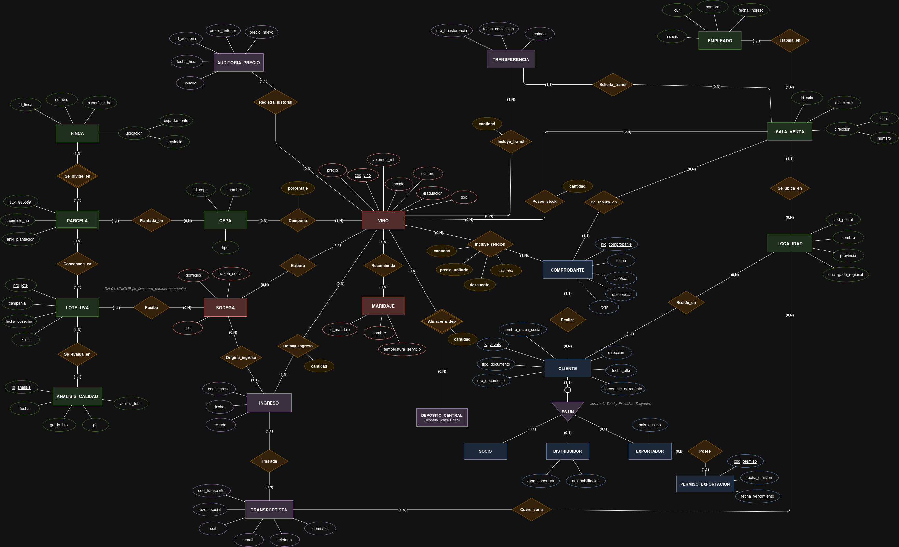
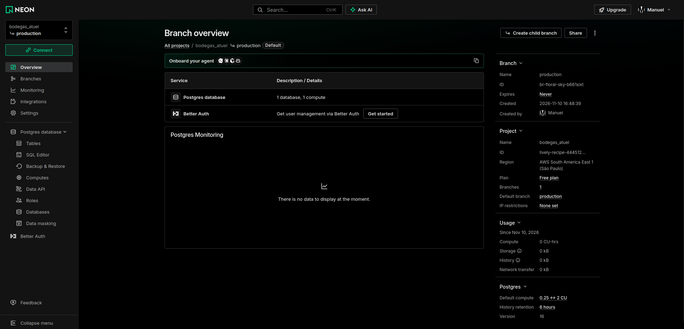
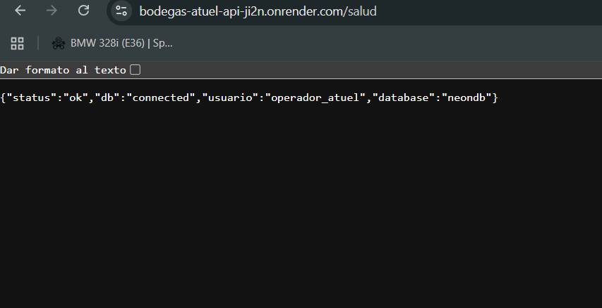
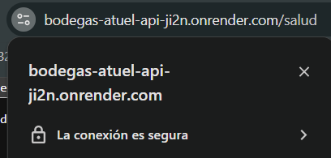
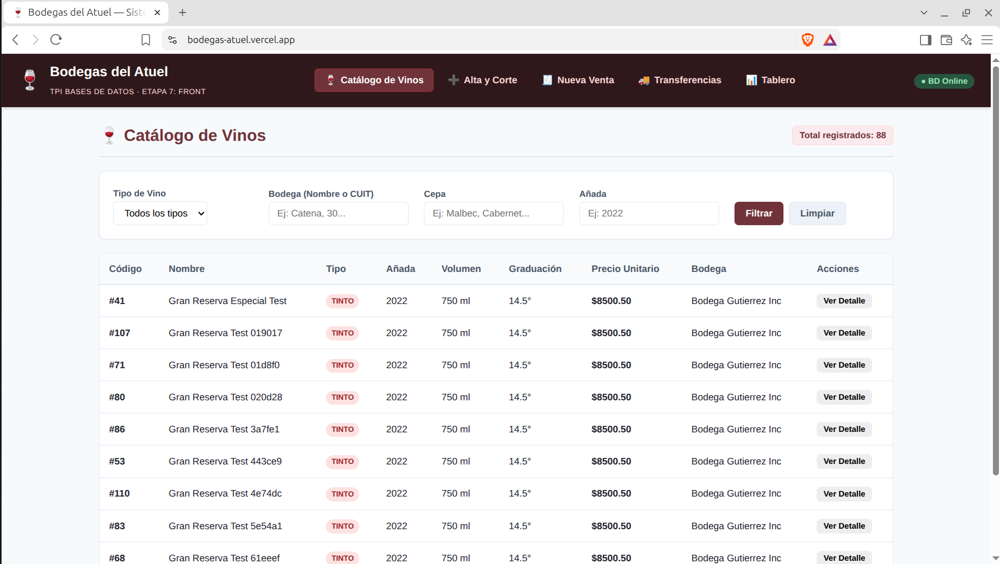
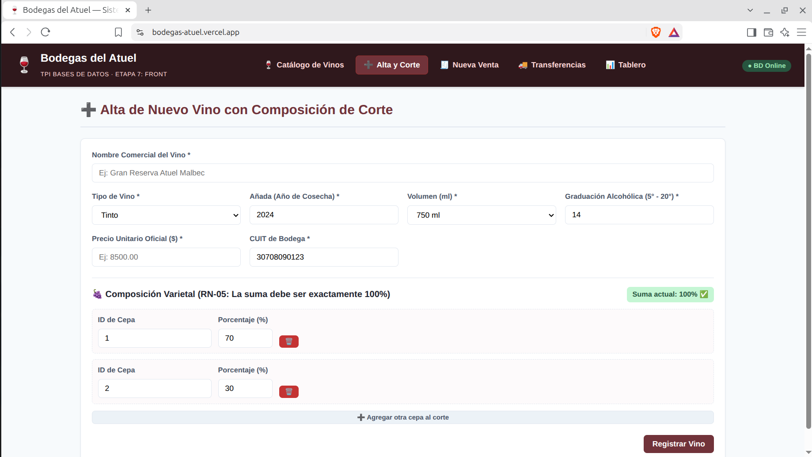
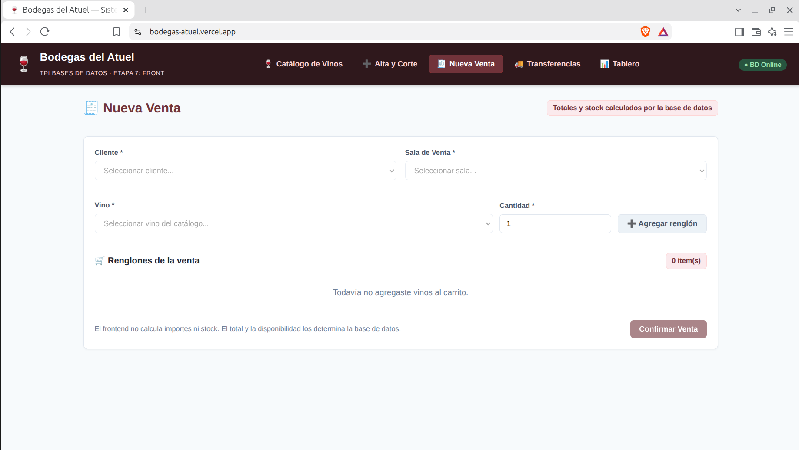
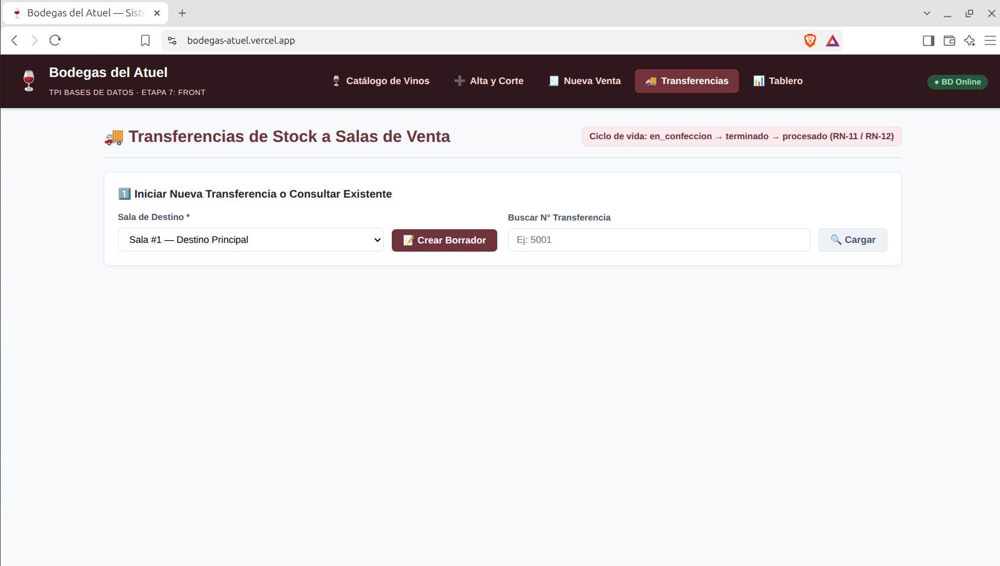
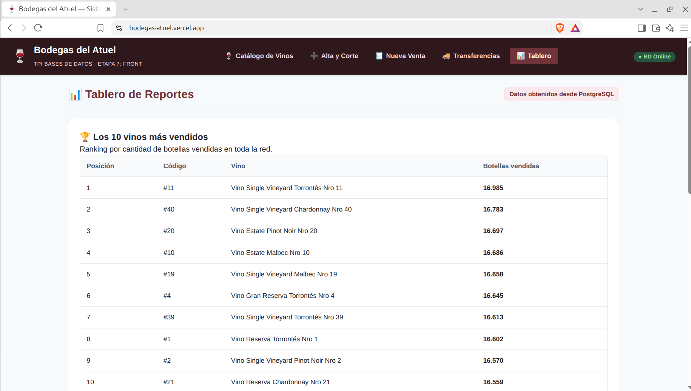

# Informe Final — Trabajo Práctico Integrador: Bodegas del Atuel

**Asignatura:** Bases de Datos — Universidad Tecnológica Nacional, Facultad Regional San Rafael (2026)  
**Integrantes del Equipo:** Bruno, Gonzalo, Juan Manuel, Manuel, Santiago

---

## 1. Introducción y Alcance

El presente documento constituye el Informe Final unificado del sistema **Bodegas del Atuel**, desarrollado a lo largo de nueve etapas evolutivas para la asignatura Bases de Datos. El objetivo del proyecto es modelar, implementar, optimizar, exponer y desplegar en producción una solución integral de base de datos relacional para un grupo vitivinícola que administra todo su ciclo productivo y comercial: desde el cultivo de vid en fincas y parcelas propias, la cosecha por campañas y los análisis fisicoquímicos de calidad, hasta la elaboración de vinos en bodegas asociadas, el control de inventario en un depósito central, la logística de abastecimiento hacia salas de venta regionales y la facturación a distintas categorías de clientes.

El alcance técnico del sistema se fundamenta en el principio de **integridad centralizada en el motor de base de datos (PostgreSQL 16)**. En lugar de delegar las validaciones críticas a las capas de aplicación, el esquema relacional garantiza por sí mismo la consistencia de los datos mediante dominios personalizados, tipos enumerados, restricciones declarativas (`PRIMARY KEY`, `FOREIGN KEY`, `UNIQUE`, `CHECK`), vistas operativas, funciones escalares, procedimientos almacenados transaccionales (`sp_procesar_ingreso`, `sp_procesar_transferencia`) y disparadores (`triggers`) que resguardan las reglas de negocio RN-01 a RN-15 y controlan la concurrencia mediante bloqueos pesimistas a nivel de fila (`SELECT ... FOR UPDATE`).

Sobre esta base sólida se construyó una arquitectura distribuida de tres capas desplegada íntegramente en la nube:
1. **Capa de Persistencia:** Motor PostgreSQL 16.15 alojado en **Neon** (región AWS São Paulo `sa-east-1`), con conexiones cifradas obligatorias (`sslmode=require`), más de 793.000 registros históricos sincronizados, índices optimizados (`B-Tree`, parciales, `INCLUDE` y `BRIN`) y separación estricta de roles (`neondb_owner`, `operador_atuel` y `auditor_atuel`).
2. **Capa de Backend (API REST):** Servicio desarrollado en **Python 3 y FastAPI** desplegado en **Render**, que implementa una Capa de Acceso a Datos (DAL) en SQL nativo 100 % parametrizado a través del driver `psycopg` v3 y `psycopg_pool`, operando exclusivamente bajo el rol de privilegios mínimos `operador_atuel` y traduciendo los códigos `SQLSTATE` de PostgreSQL a respuestas HTTP semánticas.
3. **Capa de Presentación (Frontend):** Aplicación web interactiva desarrollada en **React y Vite** desplegada en **Vercel**, que consume la API pública mediante HTTPS y permite operar el catálogo de vinos, el alta con control de corte varietal, la emisión transaccional de ventas, el flujo de estados de transferencias de stock y el tablero de reportes analíticos.

---

## 2. Modelo de Datos

### 2.1. Diagrama Entidad-Relación (DER)

El diseño conceptual del dominio se plasma en el Diagrama Entidad-Relación Extendido (ERE) ubicado en el repositorio:

*(El detalle exhaustivo de atributos, tipos y restricciones de cada tabla se complementa en el archivo `docs/03_diccionario_datos.md`).*

### 2.2. Esquema Relacional Definitivo (29 Tablas)

Convención adoptada: **PK en negrita**, *FK en cursiva*, `[UNIQUE]` entre corchetes.

#### Subdominio 1: Geografía, Salas y Producción de Uva (Responsable: Gonzalo)
1. **LOCALIDAD** (**cod_postal**, nombre, provincia, encargado_regional)
2. **SALA_VENTA** (**id_sala**, calle, numero, dia_cierre, *cod_postal*)
   - Clave Foránea: *cod_postal* referencia a **LOCALIDAD**(cod_postal).
3. **EMPLEADO** (**cuit**, nombre, fecha_ingreso, salario, *id_sala*)
   - Clave Foránea: *id_sala* referencia a **SALA_VENTA**(id_sala).
4. **FINCA** (**id_finca**, nombre `[UNIQUE]`, superficie_ha, departamento, provincia)
   - Clave Candidata (UNIQUE): (nombre).
5. **CEPA** (**id_cepa**, nombre `[UNIQUE]`, tipo)
   - Clave Candidata (UNIQUE): (nombre).
6. **PARCELA** (***id_finca*, nro_parcela**, superficie_ha, anio_plantacion, *id_cepa*)
   - Clave Foránea 1: *id_finca* referencia a **FINCA**(id_finca) *(entidad débil)*.
   - Clave Foránea 2: *id_cepa* referencia a **CEPA**(id_cepa).
7. **LOTE_UVA** (**nro_lote**, *id_finca*, *nro_parcela*, campania, fecha_cosecha, kilos, *cuit_bodega*) `[UNIQUE: (id_finca, nro_parcela, campania)]`
   - Clave Foránea 1 (compuesta): (*id_finca*, *nro_parcela*) referencia a **PARCELA**(id_finca, nro_parcela).
   - Clave Foránea 2: *cuit_bodega* referencia a **BODEGA**(cuit).
   - Clave Candidata (UNIQUE): (id_finca, nro_parcela, campania) *(RN-04: una cosecha por parcela y campaña)*.
8. **ANALISIS_CALIDAD** (**id_analisis**, *nro_lote*, fecha, grado_brix, ph, acidez_total)
   - Clave Foránea: *nro_lote* referencia a **LOTE_UVA**(nro_lote).

#### Subdominio 2: Bodegas, Vinos y Clientes (Responsable: Manuel)
1. **BODEGA** (**cuit**, razon_social `[UNIQUE]`, domicilio)
   - Clave Candidata (UNIQUE): (razon_social).
2. **VINO** (**cod_vino**, nombre, tipo, anada, volumen_ml, graduacion, precio, *cuit_bodega*) `[UNIQUE: (nombre, anada, volumen_ml)]`
   - Clave Foránea: *cuit_bodega* referencia a **BODEGA**(cuit).
   - Clave Candidata (UNIQUE): (nombre, anada, volumen_ml).
3. **COMPOSICION_VINO** (***cod_vino*, *id_cepa***, porcentaje)
   - Clave Foránea 1: *cod_vino* referencia a **VINO**(cod_vino).
   - Clave Foránea 2: *id_cepa* referencia a **CEPA**(id_cepa).
4. **MARIDAJE** (**id_maridaje**, nombre `[UNIQUE]`, temperatura_servicio)
   - Clave Candidata (UNIQUE): (nombre).
5. **VINO_MARIDAJE** (***cod_vino*, *id_maridaje***)
   - Clave Foránea 1: *cod_vino* referencia a **VINO**(cod_vino).
   - Clave Foránea 2: *id_maridaje* referencia a **MARIDAJE**(id_maridaje).
6. **CLIENTE** (**id_cliente**, nombre_razon_social, tipo_documento, nro_documento, direccion, *cod_postal*, fecha_alta, tipo_cliente, porcentaje_descuento) `[UNIQUE: (tipo_documento, nro_documento)]`
   - Clave Foránea: *cod_postal* referencia a **LOCALIDAD**(cod_postal).
   - Clave Candidata (UNIQUE): (tipo_documento, nro_documento).
7. **CLIENTE_SOCIO** (***id_cliente***)
   - Clave Foránea: *id_cliente* referencia a **CLIENTE**(id_cliente).
8. **CLIENTE_DISTRIBUIDOR** (***id_cliente***, zona_cobertura, nro_habilitacion `[UNIQUE]`)
   - Clave Foránea: *id_cliente* referencia a **CLIENTE**(id_cliente).
   - Clave Candidata (UNIQUE): (nro_habilitacion).
9. **CLIENTE_EXPORTADOR** (***id_cliente***, pais_destino)
   - Clave Foránea: *id_cliente* referencia a **CLIENTE**(id_cliente).
10. **PERMISO_EXPORTACION** (**cod_permiso**, *id_cliente*, fecha_emision, fecha_vencimiento)
    - Clave Foránea: *id_cliente* referencia a **CLIENTE_EXPORTADOR**(id_cliente) *(RN-07)*.

#### Subdominio 3: Ventas, Logística, Stock y Auditoría (Responsable: Bruno)
1. **COMPROBANTE** (**nro_comprobante**, fecha, *id_cliente*, *id_sala*, subtotal, descuento, total)
   - Clave Foránea 1: *id_cliente* referencia a **CLIENTE**(id_cliente).
   - Clave Foránea 2: *id_sala* referencia a **SALA_VENTA**(id_sala).
2. **RENGLON_COMPROBANTE** (***nro_comprobante*, *cod_vino***, cantidad, precio_unitario, descuento, subtotal)
   - Clave Foránea 1: *nro_comprobante* referencia a **COMPROBANTE**(nro_comprobante).
   - Clave Foránea 2: *cod_vino* referencia a **VINO**(cod_vino).
3. **TRANSPORTISTA** (**cod_transporte**, razon_social `[UNIQUE]`, cuit `[UNIQUE]`, email, telefono, domicilio)
4. **TRANSPORTISTA_LOCALIDAD** (***cod_transporte*, *cod_postal***)
   - Clave Foránea 1: *cod_transporte* referencia a **TRANSPORTISTA**(cod_transporte).
   - Clave Foránea 2: *cod_postal* referencia a **LOCALIDAD**(cod_postal).
5. **INGRESO** (**cod_ingreso**, fecha, estado, *cod_transporte*, *cuit_bodega*)
   - Clave Foránea 1: *cod_transporte* referencia a **TRANSPORTISTA**(cod_transporte).
   - Clave Foránea 2: *cuit_bodega* referencia a **BODEGA**(cuit).
6. **RENGLON_INGRESO** (***cod_ingreso*, *cod_vino***, cantidad)
   - Clave Foránea 1: *cod_ingreso* referencia a **INGRESO**(cod_ingreso).
   - Clave Foránea 2: *cod_vino* referencia a **VINO**(cod_vino).
7. **TRANSFERENCIA** (**nro_transferencia**, *id_sala*, fecha_confeccion, estado)
   - Clave Foránea 1: *id_sala* referencia a **SALA_VENTA**(id_sala).
8. **RENGLON_TRANSFERENCIA** (***nro_transferencia*, *cod_vino***, cantidad)
   - Clave Foránea 1: *nro_transferencia* referencia a **TRANSFERENCIA**(nro_transferencia).
   - Clave Foránea 2: *cod_vino* referencia a **VINO**(cod_vino).
9. **STOCK_SALA** (***id_sala*, *cod_vino***, cantidad)
   - Clave Foránea 1: *id_sala* referencia a **SALA_VENTA**(id_sala).
   - Clave Foránea 2: *cod_vino* referencia a **VINO**(cod_vino).
10. **STOCK_DEPOSITO** (***cod_vino***, cantidad)
    - Clave Foránea 1: *cod_vino* referencia a **VINO**(cod_vino).
11. **AUDITORIA_PRECIO** (**id_auditoria**, *cod_vino*, precio_anterior, precio_nuevo, fecha_hora, usuario)
    - Clave Foránea 1: *cod_vino* referencia a **VINO**(cod_vino).

### 2.3. Justificación de las Cinco Decisiones de Diseño

#### 1. Estrategia de Mapeo de la Jerarquía de Clientes (ERE a Relacional)
- **Naturaleza de la jerarquía:** La entidad `CLIENTE` se especializa en tres subtipos: `SOCIO` (consumidor final, 10 % de descuento), `DISTRIBUIDOR` (20 % de descuento, zona de cobertura y número de habilitación) y `EXPORTADOR` (30 % de descuento, país de destino y permisos de exportación). Semánticamente, la jerarquía es **Total y Exclusiva (Disyunta)**: todo cliente pertenece a una única categoría comercial (RN-06).
- **Alternativas evaluadas y decisión:**
  1. *Tabla única con discriminador:* Deja atributos en `NULL` y no permite restringir mediante una `FOREIGN KEY` pura que `permiso_exportacion` apunte exclusivamente a exportadores.
  2. *Una tabla por subtipo (sin tabla padre):* Triplica los atributos comunes e impide que `comprobante` tenga una única tabla `cliente` a la cual referenciar su `id_cliente`.
  3. *Supertipo + Subtipos (Opción seleccionada):* Se modela la tabla padre `cliente` con los atributos comunes y tres tablas hijas (`cliente_socio`, `cliente_distribuidor`, `cliente_exportador`) cuya clave primaria `id_cliente` es simultáneamente clave foránea (`ON DELETE CASCADE`) hacia `cliente(id_cliente)`. Esto evita nulos, permite que `comprobante` referencie limpiamente a `cliente(id_cliente)` y garantiza por estructura referencial que `permiso_exportacion(id_cliente)` apunte únicamente a `cliente_exportador(id_cliente)` (RN-07).

#### 2. Claves Naturales vs. Claves Subrogadas y Claves Compuestas
- **Claves naturales (`cuit`, `cod_postal`, `cod_permiso`):** Se conservaron en `bodega(cuit)`, `empleado(cuit)`, `localidad(cod_postal)` y `permiso_exportacion(cod_permiso)`. El CUIT y el código postal son estándares legales inmutables y unívocos, validados mediante el dominio `cuit_dom`.
- **Claves subrogadas (`INTEGER GENERATED ALWAYS AS IDENTITY`):** Se adoptaron en entidades operativas y transaccionales (`sala_venta`, `finca`, `cepa`, `lote_uva`, `analisis_calidad`, `vino`, `maridaje`, `cliente`, `comprobante`, `transportista`, `ingreso`, `transferencia`, `auditoria_precio`). Un identificador entero de 4 bytes reduce el tamaño de las páginas de índice B-Tree y acelera los `JOIN` en tablas de alto volumen (como `renglon_comprobante`, que supera las 600.000 filas). Se acompañan de restricciones `UNIQUE` sobre las claves candidatas de negocio: `UNIQUE (nombre, anada, volumen_ml)` en `vino`, `UNIQUE (tipo_documento, nro_documento)` en `cliente` y `UNIQUE (cuit)` en `transportista`.
- **Claves primarias compuestas:** Aplicadas en la entidad débil `parcela(id_finca, nro_parcela)` y en tablas asociativas y renglones (`composicion_vino`, `vino_maridaje`, `renglon_comprobante`, `renglon_ingreso`, `renglon_transferencia`, `stock_sala`, `transportista_localidad`), garantizando a nivel de índice primario que un mismo vino no pueda repetirse en dos renglones del mismo documento ni duplicar su registro de stock en una sala.

#### 3. Selección de Tipos de Datos
- **Importes monetarios y magnitudes decimales (`NUMERIC(p, s)` vs `FLOAT`):** Se descartó el punto flotante binario (`REAL`, `DOUBLE PRECISION`) para evitar errores de redondeo IEEE 754. Se utiliza `NUMERIC(12,2)` y `NUMERIC(14,2)` para precios, salarios y totales de comprobantes, y `NUMERIC(5,2)` para porcentajes de corte (que deben sumar exactamente `100.00` según RN-05) y descuentos.
- **Fechas y marcas de tiempo (`DATE` vs `TIMESTAMP`):** Se emplea `DATE` para granularidad diaria (cosechas, ingreso laboral, emisión de comprobantes, ingresos y transferencias) y `TIMESTAMP` en `auditoria_precio(fecha_hora)` para registrar el instante exacto de cada cambio de precio (RN-13).
- **Dominios y tipos enumerados (`DOMAIN` y `ENUM`):** Se define `cuit_dom` con expresión regular (`^[0-9]{11}$`) y tipos `ENUM` (`estado_documento`, `tipo_vino`, `tipo_cepa`, `tipo_cliente_enum`, `dia_semana`) para acotar los valores válidos a nivel de motor.

#### 4. Tratamiento de Atributos Derivados (Almacenados vs. Calculados)
- **Atributos calculados dinámicamente (no almacenados):** La antigüedad del empleado (`CURRENT_DATE - fecha_ingreso`) se resuelve mediante la función `fn_antiguedad_anios`, y el stock total por vino (suma de `stock_deposito` y `stock_sala`) se expone mediante la vista `vw_stock_total_vino`.
- **Atributos derivados almacenados por integridad histórica (controlados por Triggers):** En `renglon_comprobante` (`precio_unitario`, `descuento`, `subtotal`) y en `comprobante` (`subtotal`, `descuento`, `total`). Como el precio en `vino` y el porcentaje en `cliente` pueden variar en el futuro, un comprobante emitido debe conservar de forma inmutable las condiciones vigentes en el instante de la venta, calculadas automáticamente por triggers en la base de datos (RN-08).

#### 5. Políticas de Integridad Referencial (`ON DELETE` y `ON UPDATE`)
- **`ON DELETE RESTRICT` en maestros e historiales (RN-14):** Aplicado en todas las referencias hacia `bodega`, `vino`, `transportista`, `localidad`, `sala_venta`, `finca`, `cepa`, `parcela`, `lote_uva` y `cliente`, impidiendo eliminar registros maestros con historial asociado.
- **`ON DELETE CASCADE` en relaciones de composición fuerte:** Aplicado desde los renglones hacia sus cabeceras (`comprobante`, `ingreso`, `transferencia`), desde `composicion_vino` y `vino_maridaje` hacia `vino`, desde `analisis_calidad` hacia `lote_uva`, desde `parcela` hacia `finca`, y desde los subtipos hacia `cliente`.
- **`ON UPDATE CASCADE`:** Aplicado de forma general para propagar correcciones administrativas sobre claves naturales sin romper referencias.

### 2.4. Verificación de Normalización (1FN, 2FN y 3FN)

1. **Primera Forma Normal (1FN):** Todos los atributos contienen valores atómicos (la dirección en `sala_venta` se descompone en `calle` y `numero`) y se eliminaron los grupos repetitivos separando cepas por vino (`composicion_vino`), maridajes (`vino_maridaje`), cobertura (`transportista_localidad`), permisos (`permiso_exportacion`) y renglones transaccionales en tablas independientes.
2. **Segunda Forma Normal (2FN):** En todas las tablas con clave primaria compuesta (`parcela`, `composicion_vino`, `renglon_comprobante`, `renglon_ingreso`, `renglon_transferencia`, `stock_sala`), todo atributo no primo depende funcionalmente de la clave compuesta completa y no de una parte de ella.
3. **Tercera Forma Normal (3FN):** Se eliminaron las dependencias transitivas:
   - **Separación de `localidad` y `sala_venta` (RN-02):** Como cada localidad tiene un único encargado regional compartido por todas sus salas (`id_sala -> cod_postal -> encargado_regional`), `encargado_regional` reside en `localidad(cod_postal)`, erradicando anomalías de actualización.
   - **Separación de `lote_uva`, `parcela` y `cepa` (RN-04):** La cepa cosechada no se duplica en `lote_uva` porque `{id_finca, nro_parcela} -> id_cepa` ya está determinada en `parcela`. Además, `{id_finca, nro_parcela, campania}` se declara `UNIQUE` en `lote_uva`.
   - **Separación de `vino` y `bodega`:** Los datos de `bodega` (`razon_social`, `domicilio`) dependen de `cuit` y se aíslan de `vino`.
   - **Atributo `porcentaje_descuento` en `cliente` (RN-06 y U6):** Aunque el alta inicial asigna 10 %, 20 % o 30 % según `tipo_cliente`, el negocio permite modificar individualmente el descuento de un exportador al 35 % según su cantidad de permisos (consulta U6), por lo que `porcentaje_descuento` depende directamente de `id_cliente`, cumpliendo 3FN.

---

## 3. Integridad y Lógica en Base de Datos

### 3.1. Matriz de Trazabilidad de Reglas de Negocio (RN-01 a RN-15)

| Código | Regla de Negocio | Mecanismo en PostgreSQL | Prueba de Verificación (`db_tests.sql` / `pytest`) |
| :--- | :--- | :--- | :--- |
| **RN-01** | Graduación alcohólica entre 5° y 20°, añada válida y precio positivo en vinos. | Restricciones `CHECK` en tabla `vino` (`graduacion BETWEEN 5 AND 20`, `precio > 0`, `anada >= 1900`). | Intento de `INSERT` en `vino` con graduación 25° o precio negativo rechazado con `SQLSTATE 23514`. |
| **RN-02** | Cada localidad tiene un único encargado regional compartido por todas sus salas. | Normalización en 3FN: atributo `encargado_regional` en tabla `localidad(cod_postal)`. | Verificación estructural de unicidad por `cod_postal` y cruce entre salas de la misma localidad. |
| **RN-03** | Análisis de calidad con Brix (10 a 35), pH (2.5 a 4.5), acidez > 0 y fecha >= fecha de cosecha del lote. | Restricciones `CHECK` en `analisis_calidad` y trigger `trg_validar_fecha_analisis` (`BEFORE INSERT OR UPDATE`). | Intento de insertar análisis con fecha anterior a `lote_uva.fecha_cosecha` rechazado con `SQLSTATE P0001`. |
| **RN-04** | Una parcela solo puede registrar una cosecha (lote de uva) por campaña. | Restricción declarativa `UNIQUE (id_finca, nro_parcela, campania)` en `lote_uva`. | Intento de duplicar lote para la misma finca, parcela y campaña rechazado con `SQLSTATE 23505`. |
| **RN-05** | La composición varietal de todo vino debe sumar exactamente 100 %. | Constraint trigger diferido (`DEFERRABLE INITIALLY DEFERRED`) `trg_verificar_composicion_100` sobre `composicion_vino` y `vino`. | `test_crear_vino_corte_invalido_falla` en `pytest` (rechazo HTTP 409 / `SQLSTATE P0001`) y control post-carga = 0. |
| **RN-06** | Descuento inicial normativo según tipo de cliente: Socio 10 %, Distribuidor 20 %, Exportador 30 %. | Función `fn_descuento_por_tipo` y trigger `trg_asignar_descuento_cliente` (`BEFORE INSERT ON cliente`). | Alta de clientes por cada subtipo en `db_tests.sql` y `test_clientes.py` verificando el porcentaje asignado. |
| **RN-07** | Solo los clientes exportadores pueden tener permisos de exportación (`fecha_vencimiento > fecha_emision`). | `FOREIGN KEY` desde `permiso_exportacion(id_cliente)` hacia `cliente_exportador(id_cliente)` y `CHECK` de fechas. | Intento de asociar permiso a un `id_cliente` de socio o distribuidor rechazado con `SQLSTATE 23503`. |
| **RN-08** | Cálculo automático de precio, descuento y subtotal en renglón, y total neto en cabecera de comprobante. | Función `fn_total_comprobante` y triggers `trg_calcular_renglon_comprobante` y `trg_actualizar_total_comprobante`. | Control sobre 150.000 comprobantes con 0 diferencias frente a `fn_total_comprobante` y tests en `test_comprobantes.py`. |
| **RN-09** | Prohibición de vender sin stock suficiente en la sala; descuento automático y stock nunca negativo. | Trigger `trg_validar_stock_venta` con bloqueo `SELECT ... FOR UPDATE` y `CHECK (cantidad >= 0)` en `stock_sala`. | `probar_trigger_nube_h8.py` en Neon y `test_crear_venta_sin_stock_rechaza_y_revierte_transaccion` (`SQLSTATE P0001`). |
| **RN-10** | Flujo de estados en ingresos (`en_confeccion -> terminado -> procesado`) e impacto en depósito central. | Trigger de validación de estado en `ingreso` y procedimiento almacenado `sp_procesar_ingreso`. | `test_1_circuito_feliz_ingreso` y rechazo `409 Conflict` al intentar procesar un ingreso dos veces. |
| **RN-11** | Flujo de estados en transferencias, fecha actual al confeccionar y traspaso atómico depósito -> sala. | Triggers `trg_fecha_confeccion_transferencia`, validación de estados y procedimiento `sp_procesar_transferencia`. | `test_6_rn11_transferencia_stock_insuficiente` y `test_7_atomicidad_transferencia_dos_vinos` en `pytest`. |
| **RN-12** | Inmutabilidad de renglones cuando el ingreso o la transferencia no están en estado `en_confeccion`. | Función y triggers `fn_trg_bloquear_renglon` sobre `renglon_ingreso` y `renglon_transferencia`. | `test_4_rn12_bloquear_renglones_transferencia_terminada` y `test_5_rn10_bloquear_renglones_ingreso_terminado`. |
| **RN-13** | Registro automático en `auditoria_precio` ante cualquier cambio de precio en la tabla `vino`. | Trigger `trg_auditar_cambio_precio` (`AFTER UPDATE OF precio ON vino`). | Consultas U3, U5 y `test_actualizar_vino_audita_precio` verificando inserción de precio anterior, nuevo, fecha y usuario. |
| **RN-14** | Prohibición de eliminar registros maestros que posean movimientos o historial asociado. | Cláusulas `ON DELETE RESTRICT` en claves foráneas hacia entidades maestras. | `test_eliminar_vino_con_movimientos_falla` y `test_eliminar_cliente_con_comprobantes_falla` (`SQLSTATE 23503`). |
| **RN-15** | Cantidades, precios, salarios, superficies y volúmenes estrictamente válidos y positivos. | Restricciones `CHECK` en tablas operativas y dominio `cuit_dom` (`^[0-9]{11}$`). | Pruebas negativas de rangos y formatos en `tests/db_tests.sql` (`SQLSTATE 23514`). |

### 3.2. Demostración de Concurrencia: El Problema de la Última Botella

#### 1. Contexto y Nivel de Aislamiento Utilizado
En PostgreSQL, el nivel de aislamiento transaccional por defecto es `READ COMMITTED` (Lectura Confirmada). Bajo este nivel:
- Cada sentencia `SELECT` dentro de una transacción ve únicamente los datos confirmados (`COMMIT`) antes del inicio de esa sentencia `SELECT` individual (instantánea o *snapshot* de la base al inicio de la sentencia).
- No existen lecturas sucias (*Dirty Reads*), pero si dos transacciones leen el mismo dato simultáneamente sin bloquearlo y luego deciden modificarlo en base a lo leído, se produce la anomalía de **Actualización Perdida (*Lost Update*) / Condición de Carrera (*Race Condition*)**.

Para demostrar este comportamiento sobre la regla de negocio **RN-09** («No se puede vender más de lo que hay en stock de la sala. El stock nunca es negativo»), se configuró un escenario donde la Sala 1 posee en `stock_sala` únicamente 1 botella disponible (`cantidad = 1`) del Vino 1, y dos sesiones concurrentes (Terminal A y Terminal B) intentan vender esa última botella en simultáneo.

#### 2. Experimento 1: SIN Bloqueo Explícito (Lectura simple con `SELECT`)
Secuencia paso a paso:
1. Tanto la Terminal A como la Terminal B inician su transacción con `BEGIN;`.
2. La Terminal A ejecuta `SELECT cantidad FROM stock_sala WHERE id_sala = 1 AND cod_vino = 1;` y lee `1`. Al no utilizar `FOR UPDATE`, no adquiere bloqueo de escritura sobre la fila.
3. Antes de que la Terminal A confirme su venta, la Terminal B ejecuta el mismo `SELECT`. Como la Terminal A aún no ejecutó `COMMIT`, bajo `READ COMMITTED` la Terminal B también lee `cantidad = 1` y su lógica asume que hay stock disponible.
4. Ambas sesiones intentan descontar el stock. Cuando la Terminal A ejecuta `UPDATE` y `COMMIT`, deja el stock en `0`. Cuando la Terminal B intenta ejecutar su `UPDATE stock_sala SET cantidad = cantidad - 1`, choca tardíamente contra la restricción `CHECK (cantidad >= 0)` porque su validación previa sin bloqueo fue engañada por la lectura concurrente:

    -- TERMINAL A
    bodegas_atuel=# UPDATE stock_sala SET cantidad = 1 WHERE id_sala = 1 AND cod_vino = 1;
    UPDATE 1
    bodegas_atuel=# BEGIN;
    BEGIN
    bodegas_atuel=*# SELECT cantidad FROM stock_sala WHERE id_sala = 1 AND cod_vino = 1;
     cantidad
    ----------
            1
    (1 row)

    -- TERMINAL B (en simultáneo)
    bodegas_atuel=# BEGIN;
    BEGIN
    bodegas_atuel=*# SELECT cantidad FROM stock_sala WHERE id_sala = 1 AND cod_vino = 1;
     cantidad
    ----------
            1
    (1 row)

    -- TERMINAL A confirma su operación
    bodegas_atuel=*# UPDATE stock_sala SET cantidad = cantidad - 1 WHERE id_sala = 1 AND cod_vino = 1;
    UPDATE 1
    bodegas_atuel=*# COMMIT;
    COMMIT

    -- TERMINAL B falla al intentar actualizar sobre una validación obsoleta
    bodegas_atuel=*# UPDATE stock_sala SET cantidad = cantidad - 1 WHERE id_sala = 1 AND cod_vino = 1;
    ERROR:  new row for relation "stock_sala" violates check constraint "stock_sala_cantidad_check"
    DETAIL:  Failing row contains (1, 1, -1).

#### 3. Experimento 2: CON Bloqueo Explícito (`SELECT ... FOR UPDATE`)
Secuencia paso a paso implementada en los triggers y procedimientos del proyecto:
1. La Terminal A y la Terminal B inician su transacción con `BEGIN;`.
2. La Terminal A ejecuta `SELECT cantidad FROM stock_sala WHERE id_sala = 1 AND cod_vino = 1 FOR UPDATE;`. Obtiene `cantidad = 1` y, en el mismo acto, coloca un bloqueo exclusivo a nivel de fila (*row-level lock*) sobre ese registro de `stock_sala`.
3. Simultáneamente, la Terminal B ejecuta la misma sentencia `SELECT ... FOR UPDATE`. Al encontrar la fila bloqueada por la Terminal A, PostgreSQL deja a la Terminal B en espera hasta que la Terminal A finalice su transacción (`COMMIT` o `ROLLBACK`).
4. La Terminal A descuenta la botella (`UPDATE stock_sala SET cantidad = cantidad - 1...`) dejando el stock en `0`, y ejecuta `COMMIT;`.
5. En el instante exacto en que la Terminal A hace `COMMIT`, PostgreSQL libera el bloqueo y despierta a la Terminal B. En el nivel `READ COMMITTED`, `SELECT ... FOR UPDATE` reevalúa la fila con la versión recién confirmada por A y le devuelve a la Terminal B `cantidad = 0`.
6. Al recibir `0`, el trigger en la Terminal B detecta de inmediato que ya no hay existencias antes de intentar descontar y rechaza la operación de forma controlada (RN-09):

    -- TERMINAL A adquiere el bloqueo exclusivo de fila
    bodegas_atuel=# BEGIN;
    BEGIN
    bodegas_atuel=*# SELECT cantidad FROM stock_sala WHERE id_sala = 1 AND cod_vino = 1 FOR UPDATE;
     cantidad
    ----------
            1
    (1 row)

    -- TERMINAL B ejecuta la consulta con FOR UPDATE y queda en espera (bloqueada)
    bodegas_atuel=# BEGIN;
    BEGIN
    bodegas_atuel=*# SELECT cantidad FROM stock_sala WHERE id_sala = 1 AND cod_vino = 1 FOR UPDATE;
    -- (En espera del bloqueo de Terminal A...)

    -- TERMINAL A actualiza el stock y confirma la transacción
    bodegas_atuel=*# UPDATE stock_sala SET cantidad = cantidad - 1 WHERE id_sala = 1 AND cod_vino = 1;
    UPDATE 1
    bodegas_atuel=*# COMMIT;
    COMMIT

    -- TERMINAL B se desbloquea inmediatamente y lee el valor real actualizado (0)
     cantidad
    ----------
            0
    (1 row)

---

## 4. Carga Masiva de Datos (Etapa 3)

### 4.1. Definición del Orden Topológico de Inserción

Se estableció el orden estricto de inserción de datos según las dependencias de las claves foráneas (`FOREIGN KEY`) definidas en `001_esquema.sql`, evitando rechazos por integridad referencial durante la carga masiva. La secuencia se organiza en cinco niveles:

    [Nivel 1: Catálogos Raíz (CSV / Sin FK)]
     ├── localidad
     ├── cepa
     ├── maridaje
     ├── bodega
     └── transportista
           │
           ▼
    [Nivel 2: Entidades Geográficas, Estructurales y Supertipo]
     ├── sala_venta (FK -> localidad)
     ├── empleado (FK -> sala_venta)
     ├── finca
     ├── transportista_localidad (FK -> transportista, localidad)
     └── cliente (FK -> localidad)
           │
           ▼
    [Nivel 3: Subtipos y Entidades de Producción]
     ├── cliente_socio (FK -> cliente)
     ├── cliente_distribuidor (FK -> cliente)
     ├── cliente_exportador (FK -> cliente)
     │     └── permiso_exportacion (FK -> cliente_exportador)
     ├── parcela (FK -> finca, cepa)
     │     └── lote_uva (FK -> parcela, bodega)
     │           └── analisis_calidad (FK -> lote_uva)
     └── vino (FK -> bodega)
           └── auditoria_precio (FK -> vino)
           │
           ▼
    [Nivel 4: Cruces N:M e Inventario Inicial]
     ├── composicion_vino (FK -> vino, cepa)
     ├── vino_maridaje (FK -> vino, maridaje)
     ├── stock_deposito (FK -> vino)
     └── stock_sala (FK -> sala_venta, vino)
           │
           ▼
    [Nivel 5: Documentos Transaccionales (Cabeceras y Renglones)]
     ├── ingreso (FK -> transportista, bodega)
     │     └── renglon_ingreso (FK -> ingreso, vino)
     ├── transferencia (FK -> sala_venta)
     │     └── renglon_transferencia (FK -> transferencia, vino)
     └── comprobante (FK -> cliente, sala_venta)
           └── renglon_comprobante (FK -> comprobante, vino)

### 4.2. Estrategia de Manejo de Triggers durante la Carga Masiva

Durante la operación normal del sistema, los triggers de `005_triggers.sql` protegen las reglas de negocio en tiempo real. Sin embargo, al inyectar el historial de 58 meses (enero 2022 a octubre 2026, con 150.000 comprobantes y 600.000 renglones), mantener todos los triggers activos genera dos inconvenientes:
1. **Bloqueo lógico de datos históricos válidos:**
   - **RN-11 (Fecha actual en transferencias):** El trigger `BEFORE INSERT` (`trg_fecha_confeccion_transferencia`) fuerza `fecha_confeccion = CURRENT_DATE`. Si permaneciera activo durante la carga histórica, sobrescribiría la fecha de todas las transferencias pasadas con la fecha actual, arruinando la distribución temporal requerida para las consultas de la Etapa 5 (ej. S4).
   - **RN-12 (Inmutabilidad de documentos cerrados):** El trigger sobre `renglon_ingreso` y `renglon_transferencia` rechaza inserciones si la cabecera ya figura en estado `'terminado'` o `'procesado'`.
   - **RN-09 (Validación contra stock actual):** Validar ventas históricas de hace años contra la foto final de `stock_sala` rechazaría operaciones válidas si no se simula la secuencia cronológica.
2. **Degradación de rendimiento:** Ejecutar validaciones y recálculos fila por fila sobre 600.000 registros de `renglon_comprobante` multiplica las lecturas y escrituras sobre las tablas de cabecera y stock.

**Decisión Técnica (`DISABLE TRIGGER USER` y Excepción Controlada):**
En PostgreSQL existen dos variantes para desactivar triggers:
- `ALTER TABLE ... DISABLE TRIGGER ALL`: Desactiva tanto los triggers de negocio como los triggers internos del motor que implementan las `FOREIGN KEY` (`RI_ConstraintTrigger`), y exige permisos de `SUPERUSER` (incompatible con entornos gestionados en la nube).
- `ALTER TABLE ... DISABLE TRIGGER USER` (**Opción Elegida**): Desactiva únicamente los triggers definidos por el equipo en la Etapa 2, **manteniendo activas todas las restricciones `PRIMARY KEY`, `FOREIGN KEY`, `UNIQUE` y `CHECK`**.

**Flujo implementado en el repositorio:**
1. **Pre-carga (`db/seed/01_preparar_motor_pre_carga.sql`):** Ejecuta `ALTER TABLE ... DISABLE TRIGGER USER;` antes de correr `carga_maestras.py`.
2. **Reactivación post-maestras (`db/seed/02_restaurar_motor_post_carga.sql`):** Rehabilita los triggers (`ENABLE TRIGGER USER`) una vez insertados los catálogos y maestros.
3. **Carga transaccional (`db/seed/carga_h3_final.py`):** Simula mes a mes los 58 meses de inventario. Desactiva de forma aislada `trg_fecha_confeccion_transferencia` dentro de la transacción para preservar las fechas históricas 2022–2026 y lo reactiva antes del `COMMIT`.
4. **Posprocesamiento:** Se ejecuta `REFRESH MATERIALIZED VIEW mv_ventas_mensuales_sala;` y `ANALYZE;` para actualizar las estadísticas del planificador.

### 4.3. Conteo Final de Filas (Las 29 Tablas del Esquema)

Se verificó la carga completa superando las exigencias de la cátedra (todas las tablas con registros, al menos 3 tablas con más de 10.000 filas y al menos 1 tabla superando las 100.000 filas):

| # | Subdominio | Tabla | Filas Cargadas (H3) | Criterio / Observación |
| :---: | :--- | :--- | ---: | :--- |
| 1 | Geografía y Salas | `localidad` | 18 | Catálogo CSV (Departamentos de Mendoza) |
| 2 | Geografía y Salas | `sala_venta` | 6 | 6 salas distribuidas en localidades |
| 3 | Geografía y Salas | `empleado` | 18 | 3 empleados por cada sala de venta |
| 4 | Producción de Uva | `finca` | 12 | Generadas en departamentos vitivinícolas |
| 5 | Producción de Uva | `cepa` | 12 | Catálogo CSV (7 tintas y 5 blancas) |
| 6 | Producción de Uva | `parcela` | 36 | Entidad débil (3 parcelas por finca) |
| 7 | Producción de Uva | `lote_uva` | 180 | 1 cosecha por parcela por campaña (5 años) |
| 8 | Producción de Uva | `analisis_calidad` | 360 | 2 análisis fisicoquímicos por lote de uva |
| 9 | Bodegas y Vinos | `bodega` | 10 | Elaboradoras del grupo |
| 10 | Bodegas y Vinos | `vino` | 40 | Catálogo de vinos por añada y presentación |
| 11 | Bodegas y Vinos | `composicion_vino` | 60 | Cortes varietales (1 a 2 cepas sumando 100 %) |
| 12 | Bodegas y Vinos | `maridaje` | 8 | Catálogo CSV oficial |
| 13 | Bodegas y Vinos | `vino_maridaje` | 40 | Recomendaciones por vino |
| 14 | Clientes | `cliente` | 1.000 | Supertipo de la jerarquía ERE |
| 15 | Clientes | `cliente_socio` | 334 | Subtipo Socio (10 % descuento) |
| 16 | Clientes | `cliente_distribuidor` | 333 | Subtipo Distribuidor (20 % descuento) |
| 17 | Clientes | `cliente_exportador` | 333 | Subtipo Exportador (30 % descuento) |
| 18 | Clientes | `permiso_exportacion` | 333 | Permisos vigentes asociados a exportadores |
| 19 | Logística y Stock | `transportista` | 5 | Empresas de transporte registradas |
| 20 | Logística y Stock | `transportista_localidad` | 15 | 3 localidades cubiertas por transportista |
| 21 | Logística y Stock | `stock_deposito` | 40 | Stock central inicializado y conciliado |
| 22 | Logística y Stock | `stock_sala` | 240 | Matriz de stock (6 salas x 40 vinos) |
| 23 | Movimientos Stock | `ingreso` | 5.000 | Cabeceras históricas (2022–2026) |
| 24 | Movimientos Stock | `renglon_ingreso` | 14.349 | **> 10.000 filas (Tabla #1 que supera 10k)** |
| 25 | Movimientos Stock | `transferencia` | 5.000 | Cabeceras históricas hacia salas |
| 26 | Movimientos Stock | `renglon_transferencia` | 15.000 | **> 10.000 filas (Tabla #2 que supera 10k)** |
| 27 | Ventas | `comprobante` | 150.000 | **> 100.000 filas (Tabla #3 que supera 10k y 100k)** |
| 28 | Ventas | `renglon_comprobante` | 600.000 | **> 500.000 filas (Supera meta recomendada)** |
| 29 | Auditoría | `auditoria_precio` | 40 | Registro de actualizaciones de precio (RN-13) |
| - | **TOTAL GENERAL** | **29 tablas** | **792.473** | **Volumen integral verificado** |

### 4.4. Comparación de Inserción Fila por Fila versus por Lotes

Se implementó el archivo `db/seed/medir_inserciones_h3.py`, que inserta la misma muestra de 1.000 filas en una tabla temporal PostgreSQL, primero con `cursor.execute()` individual y luego con `cursor.executemany()`, revirtiendo la operación al finalizar:

| Método | Muestra | Tiempo Medido |
| :--- | ---: | ---: |
| Fila por fila (`execute`) | 1.000 | **0,1131 s** |
| Por lotes (`executemany`) | 1.000 | **0,0139 s** |

Relación temporal de esta ejecución: **8,17x**. El tiempo real registrado de generación y persistencia histórica completa fue de **19.342,15 segundos (~5 h 22 min)** para 58 meses con los triggers de negocio activos (salvo la excepción transaccional del trigger de fecha RN-11). Asimismo, mediante `db/seed/agregar_pendientes_h3.py` se incorporaron documentos en estado `en_confeccion` y `terminado` para nutrir la vista `vw_documentos_pendientes`.

### 4.5. Consultas SQL de Control Post-Carga

1. **Control de Composición Varietal (RN-05: 0 vinos que no sumen 100 %):**

    SELECT COUNT(*) AS vinos_con_corte_invalido
    FROM (
        SELECT v.cod_vino, COALESCE(SUM(cv.porcentaje), 0) AS suma_porcentaje
        FROM public.vino v
        LEFT JOIN public.composicion_vino cv ON cv.cod_vino = v.cod_vino
        GROUP BY v.cod_vino
        HAVING COALESCE(SUM(cv.porcentaje), 0) <> 100.00
    ) sub;
    -- Resultado obtenido: 0 filas.

2. **Control de Consistencia de Totales en Comprobantes (RN-08: 0 diferencias con `fn_total_comprobante`):**

    SELECT COUNT(*) AS comprobantes_descuadrados
    FROM public.comprobante c
    WHERE c.total <> public.fn_total_comprobante(c.nro_comprobante);
    -- Resultado obtenido: 0 diferencias.

3. **Control de Existencias Negativas en Depósito y Salas (RN-09 y RN-15: 0 stocks negativos):**

    SELECT
        (SELECT COUNT(*) FROM public.stock_deposito WHERE cantidad < 0) AS stock_deposito_negativo,
        (SELECT COUNT(*) FROM public.stock_sala WHERE cantidad < 0)     AS stock_sala_negativo;
    -- Resultado obtenido: 0 en depósito y 0 en salas.

4. **Control de Filas Huérfanas y Cabeceras sin Renglones (RN-10 y RN-11: 0 filas huérfanas):**

    SELECT
        (SELECT COUNT(*) FROM public.comprobante c LEFT JOIN public.renglon_comprobante rc ON rc.nro_comprobante = c.nro_comprobante WHERE rc.nro_comprobante IS NULL) AS comprobantes_sin_renglones,
        (SELECT COUNT(*) FROM public.ingreso i LEFT JOIN public.renglon_ingreso ri ON ri.cod_ingreso = i.cod_ingreso WHERE ri.cod_ingreso IS NULL) AS ingresos_sin_renglones,
        (SELECT COUNT(*) FROM public.transferencia t LEFT JOIN public.renglon_transferencia rt ON rt.nro_transferencia = t.nro_transferencia WHERE rt.nro_transferencia IS NULL) AS transferencias_sin_renglones;
    -- Resultado obtenido: 0 comprobantes vacíos, 0 ingresos vacíos y 0 transferencias vacías.

---

## 5. Índices y Rendimiento (Etapa 4)

### 5.1. Índices sobre Claves Foráneas (Responsable: Manuel)

PostgreSQL no indexa automáticamente las claves foráneas, lo que obliga al motor a realizar escaneos secuenciales (`Seq Scan`) en joins y validaciones `ON DELETE RESTRICT`. Se implementaron en `008_indices.sql` los siguientes índices B-Tree:
- **`idx_fk_comprobante_cliente`:** Evita escaneos completos al cruzar clientes con los más de 150.000 comprobantes. Optimiza las consultas **S3** y **S12**, las bajas **D1** y **D4**, y los chequeos de `ON DELETE RESTRICT`.
- **`idx_fk_renglon_transf_vino`:** Optimiza filtros y agrupaciones por vino sobre los más de 15.000 renglones de transferencia, impactando directamente en la consulta **S4**.
- **`idx_fk_ingreso_transporte`:** Acelera los cruces por empresa transportista para la consulta **S7** y la inserción **I1**.

### 5.2. Índice Compuesto, Índice Parcial e Índice Descartado (Responsable: Gonzalo)

1. **Índice Compuesto (`idx_comprobante_sala_fecha`):**

    CREATE INDEX IF NOT EXISTS idx_comprobante_sala_fecha
        ON comprobante (id_sala, fecha);

   - **Justificación del orden `(id_sala, fecha)` frente a `(fecha, id_sala)`:** Por la regla de *Igualdad antes que Rango*, en un árbol B-Tree multicolumna las columnas evaluadas por igualdad (`WHERE id_sala = 1`) se ubican a la izquierda y las evaluadas por rango (`AND fecha >= CURRENT_DATE - INTERVAL '7 days'`) a la derecha. Así, el motor navega a la sub-rama de la sala buscada y recorre contiguamente las hojas ordenadas por fecha. Además, al estar `id_sala` como prefijo izquierdo, reutiliza el índice para joins o agrupaciones solo por `id_sala` (consulta **S8**).

2. **Índice Parcial con Cláusula `WHERE` (`idx_transferencia_pendientes`):**

    CREATE INDEX IF NOT EXISTS idx_transferencia_pendientes
        ON transferencia (id_sala, fecha_confeccion)
        WHERE estado <> 'procesado';

   - **Justificación técnica:** Más del 99,9 % del historial de transferencias se encuentra en su estado final `'procesado'` (inmutable por RN-11). Las consultas operativas en tiempo real (`vw_documentos_pendientes` y **S5**) solo buscan documentos en `'en_confeccion'` o `'terminado'`. El predicado `WHERE estado <> 'procesado'` reduce el tamaño del índice en más de un 99 % y evita su mantenimiento sobre documentos cerrados.

3. **Índice Evaluado y Descartado (`idx_vino_tipo`):**

    -- INDICE DESCARTADO (No incluido en 008_indices.sql)
    CREATE INDEX idx_vino_tipo ON vino (tipo);

   - **Motivos del descarte:** Baja selectividad (`tipo_vino` solo admite 4 valores con ~25 % de la tabla cada uno) y bajo volumen de la tabla `vino` (cabe en pocas páginas de 8 KB), donde el optimizador siempre prefiere un `Seq Scan` en memoria.

### 5.3. Costo de Escritura y Almacenamiento de los Índices (Responsable: Bruno)

Mediante el script reproducible `db/seed/medir_costo_escritura_h4.py` se insertó un lote determinista de **50.000 comprobantes** y **50.000 renglones** en lotes de 5.000 filas (5 repeticiones, informando la mediana) comparando el **Escenario A (solo PK)** contra el **Escenario B (PK + índices iniciales de `008_indices.sql`)**:

| Operación | Escenario A (solo PK) | Escenario B (PK + 008) | Sobrecarga |
| :--- | ---: | ---: | ---: |
| `INSERT` de 50.000 comprobantes | **12,8783 s** | **13,6820 s** | **+6,24 %** |
| `INSERT` de 50.000 renglones (control) | 15,6054 s | 15,5745 s | -0,20 % (ruido) |
| **Total del lote (100.000 filas)** | **28,5805 s** | **29,2565 s** | **+2,37 %** |

**Resultados de almacenamiento en disco atribuibles al lote de 50.000 comprobantes:**
- `idx_fk_comprobante_cliente` (B-Tree FK): incremento de **0,53 MB** (tamaño total 0,54 MB).
- `idx_comprobante_sala_fecha` (B-Tree compuesto): incremento de **0,74 MB** (tamaño total 0,75 MB).
- **Total agregado sobre `comprobante`:** **1,27 MB** (~26 bytes por fila, equivalente a un 44 % adicional respecto de los 2,88 MB del heap de cabecera).

**Fundamento mecánico en PostgreSQL:**
- En cada `INSERT`, el motor desciende desde la raíz de cada B-Tree afectado hasta la página hoja para insertar el par `(clave, TID)`, pudiendo ocasionar divisiones de página (*page splits*) de costo `O(log n)`.
- En cada `UPDATE`, bajo MVCC se genera una nueva tupla en el heap; si cambia alguna columna indexada, no es posible aplicar optimización *HOT update* y se deben insertar nuevas entradas en todos los índices, generando *bloat* hasta la ejecución de `VACUUM`.
- En cada `DELETE`, las entradas en el heap y en los índices se marcan como muertas para su posterior recolección por `VACUUM`, aunque los índices sobre FK aceleran drásticamente la comprobación de `ON DELETE RESTRICT` y `ON DELETE CASCADE`.

### 5.4. Índices Especiales `INCLUDE`, `BRIN` y Caso Ignorado por el Planificador (Responsable: Santiago)

1. **Índice Covering con `INCLUDE` (`idx_rc_vino_include_cant`):**

    CREATE INDEX IF NOT EXISTS idx_rc_vino_include_cant
        ON renglon_comprobante (cod_vino)
        INCLUDE (cantidad, subtotal);

   Permite resolver la agregación de ventas por vino (`WHERE cod_vino = 10`) mediante un `Index Only Scan` (con solo 5 `Heap Fetches` gracias al mapa de visibilidad actualizado con `VACUUM ANALYZE`), sin recorrer las 600.000 filas del heap.

2. **Índice `BRIN` por fecha (`idx_comprobante_fecha_brin`):**

    CREATE INDEX IF NOT EXISTS idx_comprobante_fecha_brin
        ON comprobante USING brin (fecha);

   Almacena resúmenes de valores mínimo/máximo por rangos de bloques físicos, aprovechando que el historial de comprobantes fue insertado en orden cronológico.

3. **Caso de índice existente que el planificador decide no usar:**
   Ante la consulta `SELECT * FROM comprobante WHERE fecha >= DATE '2022-01-01';`, que recupera **150.000 de 150.000 filas** (100 % de la tabla), PostgreSQL ignora `idx_comprobante_fecha_brin` y elige `Seq Scan on comprobante` (`31,092 ms`), ya que cuando un filtro no descarta filas resulta más eficiente leer el heap secuencialmente que recorrer un índice.

### 5.5. Comparativa Integral `EXPLAIN (ANALYZE, BUFFERS)` (Consultas 1 a 4)

| Consulta Evaluada | Estado | Tiempo de Ejecución | Buffers (Hit / Read) | Método de Acceso Principal | Mejora de Tiempo |
| :--- | :--- | ---: | :--- | :--- | ---: |
| **C1: Reporte por Sala y Fecha** | Sin Índices | 11,678 ms | hit=1421 (1402 en tabla) | `Seq Scan` (149.582 descartadas) | - |
| **C1: Reporte por Sala y Fecha** | **Con Índices** | **1,822 ms** | **hit=52 / read=2** | `Bitmap Heap Scan` (`idx_comprobante_sala_fecha`) | **84,4 %** |
| **C2: Transferencias Pendientes** | Sin Índices | 0,644 ms | hit=94 (82 en tabla) | `Seq Scan` (5.000 descartadas) | - |
| **C2: Transferencias Pendientes** | **Con Índices** | **0,254 ms** | **hit=16 / read=1** | `Bitmap Heap Scan` (`idx_transferencia_pendientes`) | **60,9 %** |
| **C3: Totales del Vino 10** | Sin Índices | 23,935 ms | hit=32 / read=4808 | `Parallel Seq Scan` | - |
| **C3: Totales del Vino 10** | **Con Índices** | **5,973 ms** | **hit=1 / read=80** | `Index Only Scan` (`idx_rc_vino_include_cant`) | **75,0 % (4,01x)** |
| **C4: Facturación Ago–Oct 2026** | Sin Índices | 109,491 ms | hit=17 / read=6627 | `Parallel Seq Scan` | - |
| **C4: Facturación Ago–Oct 2026** | **Con Índices** | **15,155 ms** | **hit=171 / read=196** | `Bitmap Heap Scan` + `BRIN` (`idx_comprobante_fecha_brin`) | **86,2 % (7,22x)** |

#### Extracto de Planes de Ejecución (`EXPLAIN (ANALYZE, BUFFERS)`)

    === CONSULTA 1 (ANTES) ===
    GroupAggregate  (cost=3712.05..3716.13 rows=3 width=44) (actual time=10.745..10.924 rows=3 loops=1)
       Group Key: cl.tipo_cliente
       Buffers: shared hit=1421
       ->  Sort  (cost=3712.05..3713.06 rows=404 width=16) (actual time=10.435..10.526 rows=418 loops=1)
             ->  Hash Join  (cost=41.50..3694.56 rows=404 width=16) (actual time=9.284..9.835 rows=418 loops=1)
                   ->  Seq Scan on comprobante c  (cost=0.00..3652.00 rows=404 width=16) (actual time=8.514..8.881 rows=418 loops=1)
                         Filter: ((fecha >= '2026-10-01'::date) AND (id_sala = 1))
                         Rows Removed by Filter: 149582
                         Buffers: shared hit=1402
     Execution Time: 11.678 ms

    === CONSULTA 1 (DESPUES) ===
    GroupAggregate  (cost=967.90..972.06 rows=3 width=44) (actual time=1.131..1.205 rows=3 loops=1)
       Group Key: cl.tipo_cliente
       Buffers: shared hit=52 read=2
       ->  Sort  (cost=967.90..968.93 rows=412 width=16) (actual time=1.001..1.026 rows=418 loops=1)
             ->  Hash Join  (cost=50.02..950.01 rows=412 width=16) (actual time=0.441..0.656 rows=418 loops=1)
                   ->  Bitmap Heap Scan on comprobante c  (cost=8.52..907.43 rows=412 width=16) (actual time=0.086..0.203 rows=418 loops=1)
                         Recheck Cond: ((id_sala = 1) AND (fecha >= '2026-10-01'::date))
                         Heap Blocks: exact=25
                         Buffers: shared hit=25 read=2
                         ->  Bitmap Index Scan on idx_comprobante_sala_fecha  (cost=0.00..8.42 rows=412 width=0) (actual time=0.060..0.061 rows=418 loops=1)
     Execution Time: 1.822 ms

    === CONSULTA 3 (DESPUES - CON INCLUDE) ===
    GroupAggregate  (cost=0.42..680.13 rows=1 width=44) (actual time=5.866..5.868 rows=1 loops=1)
       Buffers: shared hit=1 read=80
       ->  Index Only Scan using idx_rc_vino_include_cant on renglon_comprobante  (cost=0.42..597.52 rows=16520 width=16) (actual time=0.144..3.190 rows=16686 loops=1)
             Index Cond: (cod_vino = 10)
             Heap Fetches: 5
             Buffers: shared hit=1 read=80
     Execution Time: 5.973 ms

    === CONSULTA 4 (DESPUES - CON BRIN) ===
    Sort  (cost=7245.54..7245.68 rows=58 width=44) (actual time=14.959..14.961 rows=3 loops=1)
       Buffers: shared hit=171 read=196
       ->  HashAggregate  (cost=7242.68..7243.84 rows=58 width=44) (actual time=14.906..14.909 rows=3 loops=1)
             ->  Bitmap Heap Scan on comprobante  (cost=14.03..7184.55 rows=7750 width=12) (actual time=0.862..12.840 rows=7758 loops=1)
                   Recheck Cond: ((fecha >= '2026-08-01'::date) AND (fecha <= '2026-10-31'::date))
                   Rows Removed by Index Recheck: 343
                   Heap Blocks: lossy=356
                   ->  Bitmap Index Scan on idx_comprobante_fecha_brin  (cost=0.00..12.10 rows=8654 width=0) (actual time=0.143..0.144 rows=3560 loops=1)
     Execution Time: 15.155 ms

---

## 6. Consultas SQL (Etapa 5)

La totalidad de las sentencias DML de consulta, inserción, actualización y eliminación se encuentra implementada y documentada en el directorio `consultas/`:

- **Consultas de Selección (`consultas/select.sql`):**
  - **Bloque 1 — Consultas S1 a S6 (Responsable: Bruno):**
    - **S1:** Ranking de los 10 vinos con mayor cantidad de botellas vendidas en toda la red de salas (`JOIN` entre `vino` y `renglon_comprobante`, `SUM(rc.cantidad)`, `ORDER BY total_botellas DESC, v.cod_vino LIMIT 10`).
    - **S2:** División relacional por cardinalidad para listar los vinos vendidos en todas las salas (`HAVING COUNT(DISTINCT co.id_sala) = (SELECT COUNT(*) FROM sala_venta)`).
    - **S3:** Cantidad de clientes distintos (`COUNT(DISTINCT c.id_cliente)`) de cada tipo que compraron en una sala determinada (`id_sala = 1`) en los últimos 7 días.
    - **S4:** Top 5 de salas que solicitaron mayor cantidad de un vino (`cod_vino = 1`) mediante transferencias en los últimos 15 días.
    - **S5:** Salas con menor cantidad de transferencias pendientes (`LEFT JOIN` con `t.estado <> 'procesado'` en la condición de unión y `COALESCE(COUNT(...), 0)` para conservar salas con cero pendientes).
    - **S6:** Vinos sin stock en una sala determinada (`id_sala = 1`) pero con existencias disponibles en el depósito central (`sd.cantidad > 0` y `COALESCE(ss.cantidad, 0) = 0`).
  - **Bloque 2 — Consultas Avanzadas S7 a S12 y Análisis `EXPLAIN` (Responsable: Juan Manuel):**
    - **S7:** Empresa de transporte con mayor actividad de ingresos en el último mes.
    - **S8:** Monto total de ventas por sala en el último trimestre en orden descendente.
    - **S9:** Ficha técnica integral de un vino (`cod_vino = 1`). Utiliza dos `CTE` (`CepasVino` y `MaridajesVino`) con `STRING_AGG` para pre-agregar relaciones `1:N` evitando productos cartesianos entre cepas y maridajes, cruzando finalmente con `bodega` y la vista `vw_stock_total_vino` (`Execution Time: 7,293 ms`).
    - **S10:** Rendimiento en `kg/ha` por parcela y campaña, identificando aquellas que rinden por debajo del promedio de su finca mediante `CTE` y la función de ventana `AVG(rinde_kg_ha) OVER (PARTITION BY id_finca, campania)` (`Execution Time: 0,825 ms`).
    - **S11:** Resuelta en dos sentencias con *Window Functions*: **S11-A** calcula el ranking de vinos más vendidos dentro de cada sala con `RANK() OVER (PARTITION BY c.id_sala ORDER BY SUM(rc.cantidad) DESC)` (`Execution Time: 330,233 ms`), y **S11-B** obtiene la facturación mensual y acumulada por sala mediante `SUM(SUM(total)) OVER (PARTITION BY id_sala ORDER BY DATE_TRUNC('month', fecha))` (`Execution Time: 46,286 ms`).
    - **S12:** **S12-A** implementa la división relacional estricta con doble `NOT EXISTS` (precedida por una guarda `EXISTS` para asegurar que la bodega `'20635307455'` posea vinos en catálogo) identificando los 855 clientes que compraron todos los vinos de dicha bodega (`Execution Time: 569,448 ms`), contrastada en comentarios con la variante `HAVING COUNT(DISTINCT)`. **S12-B** utiliza un *Nested Loop Anti Join* (`NOT EXISTS`) para listar los clientes que nunca compraron vino tinto (`Execution Time: 4,111 ms`).

- **Sentencias de Inserción (`consultas/insert.sql` — Responsable: Manuel):**
  Implementadas en transacciones seguras (`BEGIN; ... ROLLBACK;`) con controles posteriores:
  - **I1:** Asignación de cobertura en General Alvear (`cod_postal = '5501'`) en `transportista_localidad` al transportista con menor cantidad de ingresos en el último trimestre (`LEFT JOIN` temporal y `ORDER BY COUNT(i.cod_ingreso) ASC LIMIT 1`).
  - **I2:** Alta condicional del maridaje `'cordero al disco'` (18 °C) si existen vinos tintos con graduación >= 14.00°, asociándolo automáticamente en `vino_maridaje` mediante `INSERT ... SELECT`.
  - **I3:** Emisión de un comprobante en la sala 1 con 3 renglones tomados de vinos con stock disponible en `stock_sala`, verificando que los triggers descuenten existencias y calculen el total neto con `fn_descuento_cliente`.
  - **I4 e I5:** Inserción validada de una nueva bodega respetando `cuit_dom` y de una nueva sala de venta respetando el `ENUM dia_semana` y `CHECK (numero > 0)`.
  - **I6:** Creación de un ingreso en estado `'en_confeccion'` con un renglón de 120 botellas, comprobando que el trigger de la regla RN-12 permite la carga de detalle mientras el documento no está cerrado.

- **Sentencias de Actualización (`consultas/update.sql` — Responsable: Gonzalo):**
  Probadas dentro de transacciones (`BEGIN;` -> control previo -> `UPDATE` -> control posterior -> `ROLLBACK;`):
  - **U1:** Recálculo atómico de los **150.000 comprobantes** aplicando el descuento normativo por tipo de cliente (`fn_descuento_por_tipo`). Se resuelve mediante una `CTE` que agrega y redondea a nivel de renglón (`SUM(ROUND(r.cantidad * r.precio_unitario * (1 - pct/100.0), 2))`), garantizando `0` discrepancias matemáticas y `0` diferencias frente a `fn_total_comprobante`.
  - **U2:** Aumento salarial del 20 % para los 3 empleados con más de 5 años de antigüedad utilizando `fn_antiguedad_anios`.
  - **U3:** Incremento del 13 % en el precio de los 6 vinos de la bodega `'20635307455'`, verificando que el trigger `trg_auditar_cambio_precio` (RN-13) inserta automáticamente las 6 filas de respaldo en `auditoria_precio`.
  - **U4:** Intercambio simétrico en una única sentencia `UPDATE ... SET dia_cierre = CASE ... END` entre los días de cierre `'lunes'` y `'miercoles'` con cast explícito `::dia_semana` (2 salas afectadas).
  - **U5:** Descuento del 15 % en el precio de los 10 vinos menos vendidos de toda la red identificados mediante `CTE` con `LEFT JOIN` y `COALESCE(SUM(rc.cantidad), 0)`, auditado automáticamente en `auditoria_precio` (RN-13).
  - **U6:** Aumento del porcentaje de descuento al 35 % para los 29 clientes exportadores que registran más de 3 permisos en `permiso_exportacion` (`GROUP BY pe.id_cliente HAVING COUNT(pe.cod_permiso) > 3`).

- **Sentencias de Eliminación (`consultas/delete.sql` — Responsable: Santiago):**
  Ejecutables con `psql -X -v ON_ERROR_STOP=1 -f consultas/delete.sql`, encapsuladas en bloques transaccionales con `ROLLBACK`:
  - **D1:** Eliminación de comprobantes de socios de más de 5 años de antigüedad, verificando el borrado automático de sus renglones por `ON DELETE CASCADE` y la ausencia de renglones huérfanos.
  - **D2:** Eliminación de cepas sin vinos compuestos ni parcelas plantadas (`NOT EXISTS` sobre `composicion_vino` y `parcela`), validada mediante un fixture transaccional con ID negativo (`OVERRIDING SYSTEM VALUE`) para no alterar las secuencias `IDENTITY` tras el `ROLLBACK`.
  - **D3:** Baja de empleados con menos de 2 años de antigüedad (`fn_antiguedad_anios < 2`) en la sala de venta 5.
  - **D4 y D6:** Eliminación de clientes socios antiguos sin compras (D4) y de socios sin compras de la localidad con código postal `'5501'` (D6), comprobando el borrado en cascada sobre `cliente_socio` y la preservación de clientes con historial comercial (`ON DELETE RESTRICT`).
  - **D5:** Eliminación de ingresos en estado `'procesado'` con antigüedad mayor a 365 días, verificando que `fn_trg_bloquear_renglon` (RN-12) permite la eliminación en cascada del detalle cuando la cabecera ya fue eliminada en la misma sentencia.

---

## 7. API REST y Frontend (Etapas 6 y 7)

### 7.1. Arquitectura del Backend (`api/`)

El backend se implementó en **FastAPI** respetando la premisa de no ocultar el SQL ni duplicar en Python las reglas que residen en PostgreSQL:

    api/
    ├── config.py              # Variables de entorno y configuracion centralizada (Pydantic Settings)
    ├── database.py            # Pool de conexiones psycopg_pool y context managers transaccionales
    ├── exceptions.py          # Manejador global de excepciones PostgreSQL (SQLSTATE -> HTTP)
    ├── main.py                # Aplicacion FastAPI, lifespan, middleware CORS y registro de routers
    ├── dal/                   # Capa de Acceso a Datos (Data Access Layer - SQL nativo puro)
    │   ├── clientes.py
    │   ├── comprobantes.py
    │   ├── ingresos.py
    │   ├── reportes.py
    │   ├── salas.py
    │   ├── transferencias.py
    │   └── vinos.py
    ├── routers/               # Controladores HTTP y endpoints REST
    │   ├── clientes.py
    │   ├── comprobantes.py
    │   ├── ingresos.py
    │   ├── reportes.py
    │   ├── salas.py
    │   ├── salud.py
    │   ├── transferencias.py
    │   └── vinos.py
    └── schemas/               # Esquemas de validacion y serializacion (Pydantic v2)

- **Pool de Conexiones Resiliente (`api/database.py`):** Administrado mediante `psycopg_pool.ConnectionPool` con `row_factory=dict_row`. Incluye los parámetros `check=ConnectionPool.check_connection` y `max_idle=300.0` para validar activamente la salud de cada socket TCP antes de entregarlo a FastAPI, renovando de forma transparente las conexiones cuando el motor serverless de Neon entra en suspensión por inactividad.
- **Seguridad y Rol de Mínimos Privilegios:** La API se conecta exclusivamente con el rol `operador_atuel` (`007_roles.sql`), el cual posee permisos DML sobre las tablas operativas y `EXECUTE` sobre funciones y procedimientos, pero carece de permisos DDL o de superusuario.

### 7.2. Mapeo Centralizado de Errores (`SQLSTATE` a HTTP)

El middleware `postgres_exception_handler` en `api/exceptions.py` intercepta las excepciones de `psycopg` y las traduce a códigos HTTP semánticos conservando el mensaje diagnóstico del motor:

| Situación en PostgreSQL | Código SQLSTATE | Código HTTP Retornado | Descripción / Respuesta Semántica |
| :--- | :---: | :---: | :--- |
| Clave única violada (`UNIQUE`) | `23505` | **409 Conflict** | Conflicto: Ya existe un registro con la misma clave única o primaria. |
| Clave foránea violada (`FK`) | `23503` | **409 Conflict** | Conflicto de clave foránea: Registro relacionado inexistente o con dependencias activas (RN-14). |
| Restricción `CHECK` violada | `23514` | **422 Unprocessable Entity** | Violación de restricción CHECK en los datos ingresados (RN-01, RN-03, RN-15). |
| Restricción `NOT NULL` violada | `23502` | **422 Unprocessable Entity** | Violación de valor requerido NOT NULL. |
| Regla de negocio en trigger/SP (`RAISE EXCEPTION`) | `P0001` | **409 Conflict** | Regla de negocio rechazada por la base de datos (RN-05, RN-09, RN-10, RN-11, RN-12). |
| Formato de texto o tipo inválido | `22P02` | **400 Bad Request** | Formato de datos o tipo de dato inválido para PostgreSQL. |
| Fallo de serialización / Deadlock | `40001` / `40P01` | **503 Service Unavailable** | Conflicto de concurrencia o deadlock detectado. Reintente la operación. |

### 7.3. Demostración de Resistencia a Inyección SQL y Suite de Pruebas (`pytest`)

Todas las consultas de la capa DAL utilizan marcadores posicionales `%s` enviados por `psycopg` v3 fuera del comando SQL:
- **Vector 1 (Bypass de autenticación/filtro):** `GET /vinos?bodega=' OR '1'='1` -> PostgreSQL evalúa literalmente la cadena `%' OR '1'='1%` dentro de `ILIKE`, retornando `{"total": 0, "items": []}` con código `200 OK` sin exponer el catálogo.
- **Vector 2 (Comandos apilados):** `GET /vinos?tipo=tinto'; DELETE FROM vino;--` -> Rechazado en el borde por validación de esquema con código `422 Unprocessable Entity` sin tocar la base de datos.

La suite automatizada en `tests/` consta de **36 pruebas unitarias e integrales** que se ejecutan en **1,41 segundos**, verificando tanto los circuitos exitosos como el rechazo transaccional ante violaciones de RN-05, RN-09, RN-10, RN-11, RN-12, RN-13 y RN-14.

### 7.4. Aplicación Frontend en React (`front/src/`)

El frontend se estructuró en cinco pantallas operativas conectadas a la API REST mediante el cliente centralizado `front/src/services/api.js` y el componente de visualización de errores de base de datos `ErrorAlert`:

1. **Pantalla 1 — Catálogo de Vinos (`CatalogoVinos.jsx`, Responsable: Gonzalo):** Presenta el listado paginado de vinos con filtros combinables por tipo (`tinto`, `blanco`, `rosado`, `espumante`), bodega (nombre o CUIT), cepa y añada. Permite abrir un modal de detalle que consulta `GET /vinos/{cod_vino}` para exhibir los porcentajes exactos del corte varietal y las etiquetas de maridajes recomendados con su temperatura de servicio.
2. **Pantalla 2 — Alta de Vino con Composición de Corte (`AltaVino.jsx`, Responsable: Gonzalo):** Formulario para registrar un nuevo vino junto con sus renglones dinámicos de cepas y porcentajes. Incluye un indicador en tiempo real de la suma porcentual y permite enviar cortes inválidos (distintos de 100 %) para demostrar cómo el motor PostgreSQL aborta la transacción y devuelve el error de la regla **RN-05** (`SQLSTATE P0001` -> `409 Conflict`), el cual se renderiza en el banner de alerta.
3. **Pantalla 3 — Nueva Venta (`NuevaVenta.jsx`, Responsable: Bruno):** Carrito de facturación donde el usuario selecciona cliente, sala de venta y renglones (`cod_vino` y `cantidad`). En estricto cumplimiento de la arquitectura del proyecto, el frontend no calcula subtotales, descuentos ni disponibilidad de stock: envía el payload a `POST /comprobantes` y muestra el comprobante devuelto por la base de datos con el precio unitario oficial, el porcentaje de descuento del cliente y el total neto calculados por los triggers (**RN-08**), o el mensaje de rechazo si la sala no posee existencias suficientes (**RN-09**).
4. **Pantalla 4 — Transferencias de Stock (`Transferencias.jsx`, Responsable: Juan Manuel):** Gestiona el ciclo de vida documental de las transferencias hacia salas de venta con indicadores visuales de estado (`EN CONFECCION`, `TERMINADO`, `PROCESADO`). Permite crear un borrador o buscar una transferencia por número, agregar renglones mientras permanece en confección, pasar a estado `terminado` (bloqueando la edición de renglones por **RN-12**) e invocar `POST /transferencias/{nro}/procesar`, que ejecuta `CALL sp_procesar_transferencia` (**RN-11**). Incorpora además un botón de prueba para forzar el procesamiento sin terminar y verificar en vivo el rechazo `409 Conflict` de la base de datos.
5. **Pantalla 5 — Tablero de Reportes (`TableroReportes.jsx`, Responsable: Santiago):** Panel gerencial alimentado directamente por las consultas SQL de la Etapa 5 expuestas en `/reportes`: tabla de los 10 vinos más vendidos en la red (**S1**), gráfico comparativo de barras horizontales con la facturación por sala del último trimestre (**S8**) y selector dinámico de sala para consultar los vinos agotados en dicha sucursal que cuentan con stock disponible en el depósito central (**S6**).

---

## 8. Despliegue en la Nube y Seguridad (Etapa 8)

### 8.1. Selección del Proveedor Cloud y Configuración de PostgreSQL (Responsable: Manuel)

| Criterio de Selección | Neon (Elegido) | Supabase | Render PostgreSQL |
| :--- | :--- | :--- | :--- |
| **Versión PostgreSQL** | **16.15 nativa** | 15.x / 16.x | 16.x |
| **Almacenamiento Gratuito** | 500 MB (la base ocupa 113 MB) | 500 MB | 1 GB (expira a los 30 días) |
| **Cifrado en Tránsito (SSL)** | **Obligatorio por defecto** (`sslmode=require`) | Opcional / Habilitado | Habilitado |
| **Región Geográfica** | **AWS São Paulo (`sa-east-1`)** | AWS N. Virginia (`us-east-1`) | Oregon / Frankfurt |
| **Latencia desde Argentina** | **35 - 50 ms** | 140 - 180 ms | 160 - 200 ms |

Se seleccionó **Neon** por su compatibilidad nativa con PostgreSQL 16.15, baja latencia regional desde Argentina (`sa-east-1`) y exigencia obligatoria de TLS/SSL (`sslmode=require`). Se aplicaron las migraciones `001` a `008` y se configuraron los roles `neondb_owner` (administración), `operador_atuel` (uso exclusivo de la API REST, sin permisos DDL) y `auditor_atuel` (solo lectura).

### 8.2. Sincronización Masiva a la Nube y Auditoría Post-Carga (Responsable: Gonzalo)

Para evitar la latencia de red al migrar 793.769 filas hacia Brasil, se desarrolló el script `db/seed/migrar_a_nube_h8.py` utilizando el protocolo binario `COPY BINARY` de `psycopg` v3, desactivando temporalmente los triggers de usuario (`DISABLE TRIGGER USER`), respetando los cinco niveles topológicos y sincronizando las 13 secuencias `IDENTITY` mediante `setval`:
- **Duración total de la migración a Neon:** **30,18 segundos**.
- **Volumen total sincronizado:** **793.769 filas** en las 29 tablas (`renglon_comprobante`: 600.022; `comprobante`: 150.022; `renglon_transferencia`: 15.109; `renglon_ingreso`: 14.389; tablas maestras y catálogos: 14.227).
- **Auditoría de Integridad en Neon:** Rehabilitados los triggers (`ENABLE TRIGGER USER`), las cuatro consultas de control arrojaron **0 cortes inválidos (RN-05)**, **0 diferencias de totales (RN-08)**, **0 stocks negativos (RN-09/15)** y **0 documentos sin renglones (RN-10/11)**.

### 8.3. Prueba de Trigger en Vivo en la Nube (Responsable: Gonzalo)

Se ejecutó `db/seed/probar_trigger_nube_h8.py` contra Neon intentando vender **5.045 botellas** del Vino 10 en la Sala 3, la cual disponía de **4.045 botellas**:

    Codigo SQLSTATE : P0001
    Funcion PL/pgSQL: PL/pgSQL function fn_trg_validar_stock_venta() line 42 at RAISE
    Mensaje de Error: Stock insuficiente del vino 10 en la sala 3: disponible 4045, requerido 5045 (RN-09)

Tras el `ROLLBACK`, la consulta de control verificó `0` filas residuales para el comprobante abortado, certificando la atomicidad en la nube.

### 8.4. Procedimiento de Respaldo y Restauración — Disaster Recovery (Responsable: Bruno)

Se validó el circuito completo de respaldo desde la base de producción `neondb` hacia una base testigo limpia `bodegas_atuel_test_restore` en Neon utilizando `pg_dump` y `pg_restore` 16.15 con credenciales inyectadas por variables de entorno:

    # 1. Crear la base testigo limpia en el proveedor
    psql "$NEON_URL" -v ON_ERROR_STOP=1 \
      -c 'DROP DATABASE IF EXISTS bodegas_atuel_test_restore WITH (FORCE);' \
      -c 'CREATE DATABASE bodegas_atuel_test_restore;'

    # 2. Generar volcado completo en formato comprimido custom (-Fc)
    pg_dump "$NEON_URL" -Fc -f /tmp/opencode/backup_bodegas_atuel.dump

    # 3. Restaurar en la base testigo sin errores ni advertencias
    pg_restore -d "$TEST_URL" --clean --if-exists --no-owner --no-privileges \
      /tmp/opencode/backup_bodegas_atuel.dump

- **Métricas:** Tamaño del dump `5,3 MB`, duración de `pg_dump` `37,17 s`, duración de `pg_restore` `62,11 s`, código de salida `0` (`0 errores / 0 warnings`).
- **Certificación de Paridad 1:1:** La verificación cruzada sobre las 29 tablas del esquema confirmó exactamente **793.769 filas en producción** y **793.769 filas en la base testigo** (`Diferencia = 0` en todas las tablas).

### 8.5. Despliegue de API en Render, Frontend en Vercel y Auditoría de Git (Responsables: Juan Manuel y Santiago)

- **Backend en Render:** Publicado con HTTPS y certificado TLS activo (`https://bodegas-atuel-api-ji2n.onrender.com` / `https://bodegas-atuel-api.onrender.com`), conectado a Neon bajo el rol `operador_atuel` con `DB_SSLMODE=require`.
- **Frontend en Vercel:** Publicado en `https://bodegas-atuel.vercel.app` vinculando `VITE_API_URL` hacia el servicio de Render y verificando la navegación sin errores de CORS en las cinco pantallas del sistema.
- **Auditoría de Seguridad en Git:** La inspección del historial completo del repositorio (`git log --all --name-only | grep -E '\.env$|\.env\.'`) confirmó que únicamente se versionaron las plantillas `.env.example` y `front/.env.example`, cumpliendo la política de **Cero Secretos en Git**.

---

## 9. Conclusiones y Lecciones Aprendidas

El desarrollo integral del proyecto **Bodegas del Atuel** a través de sus nueve etapas permitió al equipo contrastar los fundamentos teóricos del modelo relacional con los desafíos reales de una arquitectura transaccional en producción:

1. **El valor de la integridad en el motor de base de datos:** Delegar las reglas de negocio (RN-01 a RN-15) a restricciones declarativas, procedimientos almacenados y triggers en PostgreSQL demostró ser una decisión arquitectónica superior frente a la validación exclusiva en el backend. Incluso ante accesos concurrentes o intentos de operaciones fuera de secuencia desde distintos clientes, la base de datos actuó como única fuente de verdad, impidiendo estados inconsistentes como stocks negativos, cortes varietales incompletos o comprobantes descuadrados.
2. **Concurrencia y bloqueos explícitos:** La experimentación práctica sobre el problema de la última botella evidenció que el nivel de aislamiento `READ COMMITTED` por sí solo no alcanza para evitar condiciones de carrera cuando la lógica lee antes de escribir. La incorporación de bloqueos pesimistas a nivel de fila (`SELECT ... FOR UPDATE`) dentro de los triggers y procedimientos almacenados fue determinante para serializar correctamente el acceso a las filas críticas de inventario.
3. **Equilibrio entre lógica de negocio y cargas masivas:** Uno de los mayores retos técnicos surgió en la Etapa 3 al generar y persistir 58 meses de historia transaccional (+790.000 filas). Aprendimos a distinguir entre los triggers internos de integridad referencial y los triggers de usuario (`DISABLE TRIGGER USER`), así como la enorme diferencia de rendimiento entre inserciones individuales, lotes `executemany` y el protocolo de streaming binario `COPY BINARY` empleado en la Etapa 8 para sincronizar la base en la nube en apenas 30 segundos.
4. **Indexación empírica basada en costos:** El análisis de planes de ejecución con `EXPLAIN (ANALYZE, BUFFERS)` y el benchmark de escritura de la Etapa 4 demostraron que indexar no consiste en agregar índices indiscriminadamente. Comprobamos cómo un índice parcial (`WHERE estado <> 'procesado'`), un índice *covering* (`INCLUDE`) o un índice `BRIN` sobre series temporales reducen drásticamente las lecturas de bloques con un costo marginal de almacenamiento y escritura, mientras que índices sobre columnas de baja selectividad o tablas pequeñas son descartados por el optimizador.
5. **Ingeniería en la nube y resiliencia serverless:** Al llevar la solución a producción con Vercel, Render y Neon, enfrentamos la suspensión automática por inactividad propia de las bases de datos *serverless*. La incorporación de validación activa de sockets (`check=ConnectionPool.check_connection` y `max_idle=300.0`) en el pool de conexiones de la API permitió absorber los arranques en frío sin exponer errores al usuario final.
6. **Qué haríamos distinto al iniciar un nuevo proyecto:** Si comenzáramos el proyecto hoy, configuraríamos desde el primer día la validación de conexiones `check_connection` en el pool pensando en entornos *serverless*, automatizaríamos mediante integración continua la ejecución de `tests/db_tests.sql` y `pytest` en cada Pull Request, y diseñaríamos desde la Etapa 3 los lotes de prueba específicos para los casos borde de las consultas de modificación y borrado de la Etapa 5.
