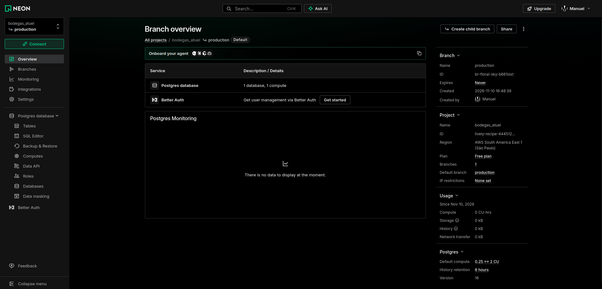
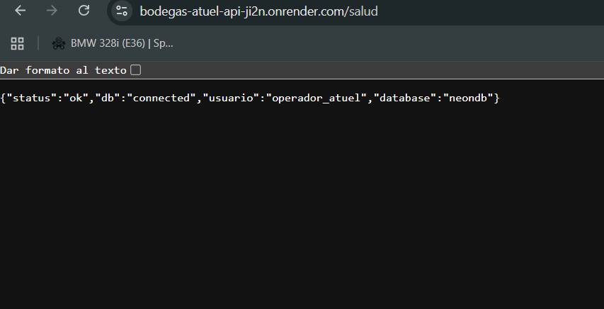
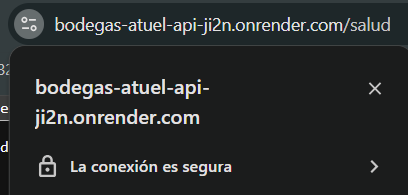
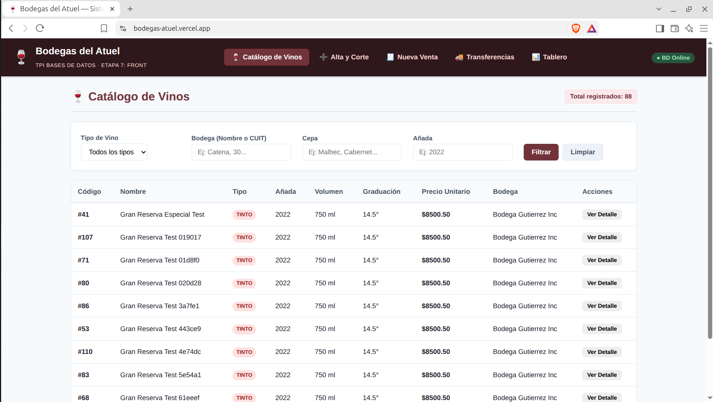
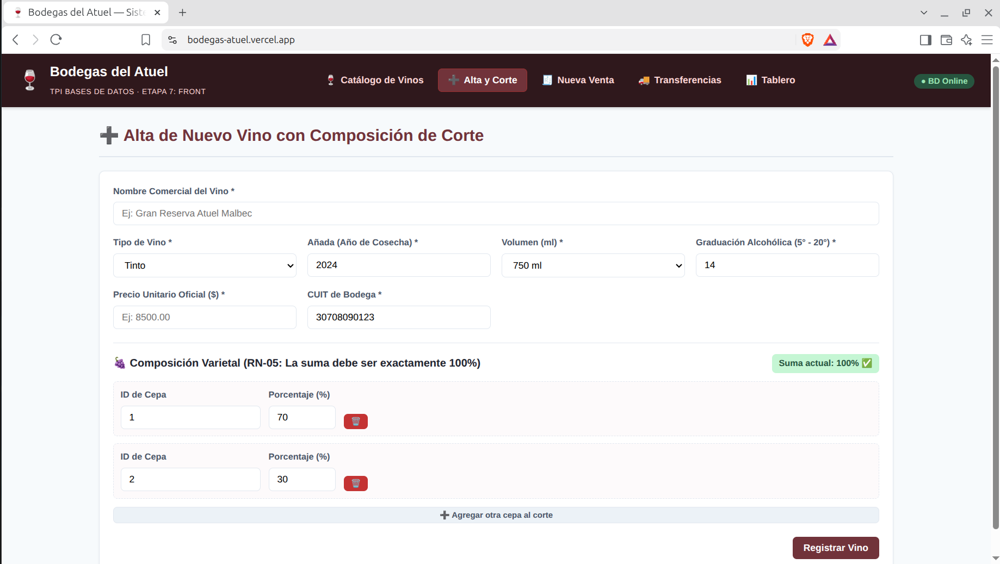
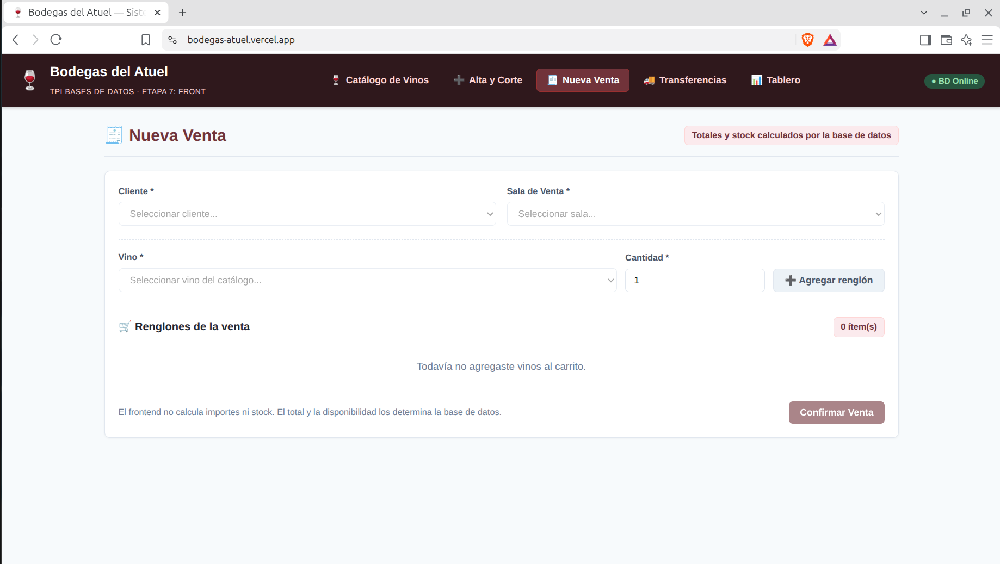
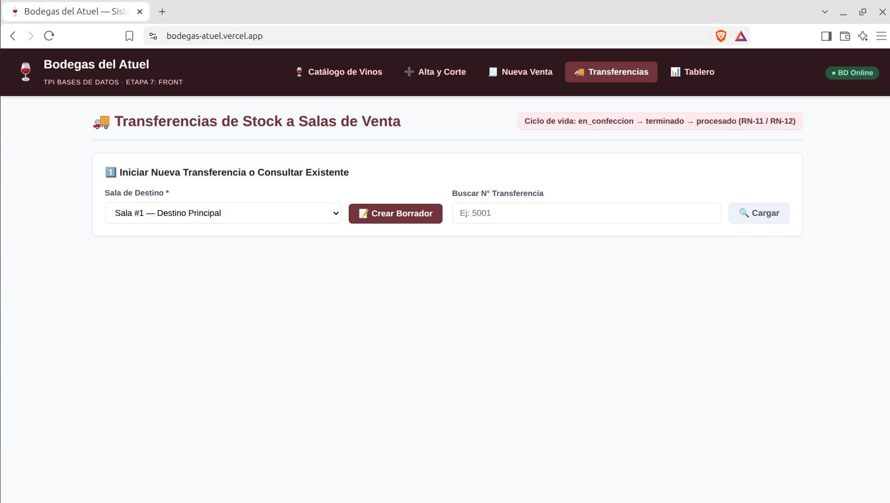
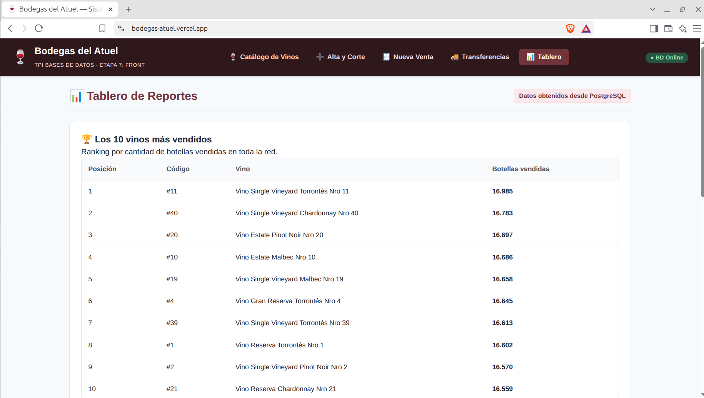

# Informe Etapa 8 (H8): Despliegue en la Nube, Seguridad y Operación

**Proyecto:** Bodegas del Atuel  
**Asignatura:** Bases de Datos — UTN FRSR (2026)  
**Equipo:** Gonzalo, Manuel, Bruno, Juan Manuel, Santiago  


## 1. Introducción y Objetivos de la Etapa

El objetivo fundamental de la **Etapa 8** es llevar el sistema integral de **Bodegas del Atuel** a un entorno de producción real en la nube, garantizando las medidas de seguridad, confidencialidad, integridad y disponibilidad exigidas para arquitecturas empresariales:

1. **Base de Datos PostgreSQL 16 en la nube:** Despliegue en un proveedor gestionado con cifrado de transporte forzado (`sslmode=require`) y esquemas relacionales completos.
2. **Carga masiva íntegra:** Sincronización de los 58 meses históricos de datos (+790.000 filas) sin omisiones y validando la paridad con el entorno local.
3. **Mínimos privilegios y roles:** Separación estricta de perfiles (`admin_atuel` / `neondb_owner`, `operador_atuel` para backend y `auditor_atuel` para consultas).
4. **Verificación de reglas de negocio y triggers en vivo:** Evidencia fehaciente de que las reglas de negocio (especialmente RN-09: control de stock físico) continúan protegiendo los datos en el servidor cloud ante intentos de evasión.
5. **Procedimiento de respaldo y restauración (Disaster Recovery):** Generación de volcado con `pg_dump`, restauración en base testigo y prueba de consistencia 1:1.
6. **Seguridad y Cero Secretos:** Inexistencia de contraseñas o tokens en el código fuente o historial de Git.

---

## 2. Infraestructura de Base de Datos en la Nube (Manuel)

### 2.1 Comparación de Proveedores y Decisión

| Criterio de Selección | Neon (Elegido) | Supabase | Render PostgreSQL |
| :--- | :--- | :--- | :--- |
| **Versión PostgreSQL** | **16.15 nativa** | 15.x / 16.x | 16.x |
| **Almacenamiento Gratuito** | 500 MB (nuestra base pesa 113 MB) | 500 MB | 1 GB (expira a los 30 días) |
| **Cifrado en Tránsito (SSL)** | **Obligatorio por defecto** (`sslmode=require`) | Opcional / Habilitado | Habilitado |
| **Región Geográfica** | **AWS São Paulo (`sa-east-1`)** | AWS us-east-1 (N. Virginia) | Oregon / Frankfurt |
| **Latencia desde Argentina** | **35 - 50 ms** | 140 - 180 ms | 160 - 200 ms |

**Justificación:** Se seleccionó **Neon** debido a su compatibilidad nativa con PostgreSQL 16, su baja latencia al contar con datacenter en São Paulo (`sa-east-1`), y la obligatoriedad estricta de TLS/SSL en todas las conexiones entrantes.

### 2.2 Migraciones y Esquema en Nube
Se ejecutaron secuencialmente todas las migraciones del repositorio (`001_esquema.sql` a `008_indices.sql`), estableciendo las 29 tablas base y las 2 vistas del sistema.

### 2.3 Roles y Seguridad
Se aprovisionaron los roles de negocio con credenciales robustas:
* `operador_atuel`: Rol asignado a la API REST con permisos de lectura y escritura (`SELECT`, `INSERT`, `UPDATE`, `DELETE`) en tablas operativas y secuencias, sin permisos de modificación de esquema (`DDL`).
* `auditor_atuel`: Rol de solo lectura (`SELECT`).



---

## 3. Carga Masiva de Datos y Secuencias (Gonzalo)

Para evitar la latencia excesiva que ocasionaría insertar 793.769 filas mediante comandos individuales a través de internet, se implementó el script de sincronización `db/seed/migrar_a_nube_h8.py` basado en el protocolo binario de PostgreSQL:

```bash
python db/seed/migrar_a_nube_h8.py
```

### 3.1 Estrategia de Inserción y Manejo de Triggers
1. **Desactivación temporal de triggers de usuario:**  
   Se ejecutó `ALTER TABLE ... DISABLE TRIGGER USER` sobre todas las tablas públicas. Esto permite insertar fechas históricas de transferencias (RN-11) y cabeceras cerradas (RN-12) sin bloqueos indebidos, conservando siempre activas las validaciones estructurales de integridad del motor (claves foráneas y checks).
2. **Orden topológico estricto:**  
   La migración respetó la jerarquía de cinco niveles de dependencias para garantizar consistencia referencial.
3. **Streaming Binario (`COPY BINARY`):**  
   Los datos fluyeron directamente desde la instancia local hacia Neon en representación binaria.
4. **Sincronización de Secuencias:**  
   Se actualizaron las 13 secuencias (`SERIAL` / `IDENTITY`) mediante `setval` con su `last_value` correspondiente, evitando colisiones de clave primaria al operar desde la API.

### 3.2 Métricas de Carga
* **Duración total:** **30,18 segundos**.
* **Volumen sincronizado:** **793.769 filas** (29 tablas).
  * `renglon_comprobante`: 600.022 filas
  * `comprobante`: 150.022 filas
  * `renglon_transferencia`: 15.109 filas
  * `renglon_ingreso`: 14.389 filas
  * Tablas maestras y catálogos: 14.227 filas

---

## 4. Consultas de Control Post-Carga (Auditoría de Integridad)

Tras rehabilitar los triggers de usuario (`ENABLE TRIGGER USER`), se ejecutaron las cuatro consultas de auditoría oficial de la Etapa 3 directamente sobre Neon:

| Regla de Negocio Auditada | Consulta de Control | Resultado Obtenido | Estado |
| :--- | :--- | :---: | :---: |
| **RN-05 (Cortes de vino)** | Vinos cuya suma en `composicion_vino` $\neq 100\,\%$ | **0 filas** | ✅ Cumple |
| **RN-08 (Totales de venta)** | Comprobantes con `total` $\neq$ `fn_total_comprobante()` | **0 diferencias** | ✅ Cumple |
| **RN-09 / RN-15 (Existencias)** | Existencias negativas en `stock_deposito` o `stock_sala` | **0 en depósito / 0 en salas** | ✅ Cumple |
| **RN-10 / RN-11 (Integridad)** | Comprobantes, ingresos o transferencias sin renglones | **0 huérfanos** | ✅ Cumple |

---

## 5. Prueba de Trigger Vivo en la Nube (Gonzalo)

Para certificar el cumplimiento del **Punto 9 de la Etapa 8**, se ejecutó la prueba automatizada `db/seed/probar_trigger_nube_h8.py` contra el motor en la nube:

### 5.1 Caso de Prueba: Intento de Venta sin Stock (RN-09)
* **Entorno de prueba:** Sala de Venta ID 3, Vino ID 10 (*Vino Estate Malbec Nro 10*).
* **Stock físico disponible:** **4.045 botellas**.
* **Operación ejecutada:** Intento de inserción de un renglón solicitando **5.045 botellas** (excedente no permitido).

### 5.2 Respuesta del Motor Remoto
El trigger `trg_validar_stock_venta` interceptó la operación antes de la confirmación:
```text
Código SQLSTATE : P0001
Función PL/pgSQL: PL/pgSQL function fn_trg_validar_stock_venta() line 42 at RAISE
Mensaje de Error: Stock insuficiente del vino 10 en la sala 3: disponible 4045, requerido 5045 (RN-09)
```

### 5.3 Control de Atomicidad (ACID)
Tras capturarse la excepción, se ejecutó `ROLLBACK`. La verificación posterior demostró:
```sql
SELECT COUNT(*) FROM comprobante WHERE nro_comprobante = 152646;
-- Resultado: 0 filas
```
No quedaron registros residuales ni cabeceras huérfanas, demostrando la consistencia transaccional del sistema.

---

## 6. Procedimiento de Respaldo y Restauración (Bruno)

### 6.1 Alcance y entorno de la prueba

Se validó el circuito completo de **Disaster Recovery** sobre la base de producción ya cargada en Neon:

* **Motor origen:** PostgreSQL 16.15 (Neon, región AWS `sa-east-1`).
* **Base origen:** `neondb` (producción, usuario administrador `neondb_owner`).
* **Base testigo:** `bodegas_atuel_test_restore` (creada limpia para esta prueba).
* **Cliente de respaldo:** `pg_dump` / `pg_restore` 16.15.
* **Fecha de ejecución:** 10/11/2026.

Las credenciales se pasaron en tiempo de ejecución mediante variables de entorno y **no se persisten en el repositorio ni en el historial de Git**.

### 6.2 Comandos exactos ejecutados

```bash
# 0. Variables de conexión (el secreto se inyecta en runtime, no se versiona)
export NEON_URL="postgresql://neondb_owner:****@<HOST_NEON>/neondb?sslmode=require&channel_binding=require"
export TEST_URL="${NEON_URL/\/neondb\?/\/bodegas_atuel_test_restore\?}"

# 1. Crear la base testigo limpia en el proveedor
psql "$NEON_URL" -v ON_ERROR_STOP=1 \
  -c 'DROP DATABASE IF EXISTS bodegas_atuel_test_restore WITH (FORCE);' \
  -c 'CREATE DATABASE bodegas_atuel_test_restore;'

# 2. Dump completo en formato custom (-Fc)
pg_dump "$NEON_URL" -Fc -f /tmp/opencode/backup_bodegas_atuel.dump

# 3. Restauración en la base testigo
pg_restore -d "$TEST_URL" --clean --if-exists --no-owner --no-privileges \
  /tmp/opencode/backup_bodegas_atuel.dump
```

> **Nota sobre los flags:** además de `--clean --no-owner` se agregaron `--if-exists` (evita que el `DROP` de `--clean` falle sobre objetos inexistentes en una base recién creada) y `--no-privileges` (evita errores de `ALTER DEFAULT PRIVILEGES` sobre roles de negocio que `neondb_owner` no administra en esta base). Con ambos flags la restauración finalizó con **exit code 0, 0 errores y 0 warnings**. La primera ejecución con `--clean --no-owner` ya había restaurado los datos, pero devolvía exit code 1 por esos `DROP`/privilegios esperables.

### 6.3 Métricas de la operación

| Métrica | Valor |
| :--- | :--- |
| Versión del motor | PostgreSQL 16.15 (Neon `sa-east-1`) |
| Tablas de datos en el dump | 29 |
| Tamaño del dump (`-Fc`) | 5,3 MB |
| Duración `pg_dump` | 37,17 s |
| Duración `pg_restore` | 62,11 s |
| Exit code `pg_restore` | 0 |
| Errores / warnings del restore | 0 / 0 |
| Filas totales en producción | 793.769 |
| Filas totales en la base testigo | 793.769 |

### 6.4 Verificación cruzada de conteos (producción vs. testigo)

Consulta aplicada en ambas bases:

```sql
SELECT 'comprobante' AS tabla, count(*) AS filas FROM comprobante
UNION ALL SELECT 'renglon_comprobante', count(*) FROM renglon_comprobante
UNION ALL SELECT 'vino', count(*) FROM vino
UNION ALL SELECT 'cliente', count(*) FROM cliente
UNION ALL SELECT 'stock_sala', count(*) FROM stock_sala
ORDER BY tabla;
```

**Tablas clave:**

| Tabla | Producción (`neondb`) | Testigo (`bodegas_atuel_test_restore`) | Diferencia |
| :--- | ---: | ---: | ---: |
| `comprobante` | 150.022 | 150.022 | **0** |
| `renglon_comprobante` | 600.022 | 600.022 | **0** |
| `vino` | 88 | 88 | **0** |
| `cliente` | 1.100 | 1.100 | **0** |
| `stock_sala` | 240 | 240 | **0** |

**Control extendido: las 29 tablas base**

La comparación se repitió sobre las 29 tablas del esquema `public` (conteo exacto por tabla vía `information_schema` + `query_to_xml`). El `diff` entre ambos resultados fue vacío: **paridad 1:1 en todas las tablas**.

| Tabla | Producción | Testigo | Diferencia |
| :--- | ---: | ---: | ---: |
| `analisis_calidad` | 330 | 330 | 0 |
| `auditoria_precio` | 24 | 24 | 0 |
| `bodega` | 10 | 10 | 0 |
| `cepa` | 12 | 12 | 0 |
| `cliente` | 1.100 | 1.100 | 0 |
| `cliente_distribuidor` | 353 | 353 | 0 |
| `cliente_exportador` | 347 | 347 | 0 |
| `cliente_socio` | 400 | 400 | 0 |
| `composicion_vino` | 133 | 133 | 0 |
| `comprobante` | 150.022 | 150.022 | 0 |
| `empleado` | 21 | 21 | 0 |
| `finca` | 11 | 11 | 0 |
| `ingreso` | 5.040 | 5.040 | 0 |
| `localidad` | 18 | 18 | 0 |
| `lote_uva` | 165 | 165 | 0 |
| `maridaje` | 8 | 8 | 0 |
| `parcela` | 33 | 33 | 0 |
| `permiso_exportacion` | 695 | 695 | 0 |
| `renglon_comprobante` | 600.022 | 600.022 | 0 |
| `renglon_ingreso` | 14.389 | 14.389 | 0 |
| `renglon_transferencia` | 15.109 | 15.109 | 0 |
| `sala_venta` | 6 | 6 | 0 |
| `stock_deposito` | 40 | 40 | 0 |
| `stock_sala` | 240 | 240 | 0 |
| `transferencia` | 5.093 | 5.093 | 0 |
| `transportista` | 5 | 5 | 0 |
| `transportista_localidad` | 15 | 15 | 0 |
| `vino` | 88 | 88 | 0 |
| `vino_maridaje` | 40 | 40 | 0 |
| **TOTAL** | **793.769** | **793.769** | **0** |

### 6.5 Certificación

La diferencia de filas entre producción y la base restaurada es **exactamente 0** en las cinco tablas clave y en la totalidad de las 29 tablas. El dump generado con `pg_dump -Fc` es restaurable de forma íntegra con `pg_restore`, por lo que **se certifica la paridad 1:1** y la validez del procedimiento de respaldo/restauración para el plan de continuidad del sistema.

---

## 7. Despliegue de API y Frontend (Juan Manuel y Santiago)

**URL Pública de la API:** https://bodegas-atuel-api-ji2n.onrender.com/



### 7.1. Arquitectura del sistema en producción

El sistema Bodegas del Atuel se desplegó utilizando una arquitectura distribuida de tres componentes:

- **Frontend:** React y Vite, alojados en Vercel.
- **Backend:** API REST desarrollada con FastAPI, alojada en Render.
- **Base de datos:** PostgreSQL 16, alojada en Neon.

La comunicación sigue el flujo:

**React (Vercel) → FastAPI (Render) → PostgreSQL (Neon)**

Los servicios se comunican mediante conexiones HTTPS y, para la conexión con PostgreSQL, se utiliza SSL/TLS.

### 7.2. Despliegue del backend en Render

La API REST se encuentra disponible públicamente en:

**https://bodegas-atuel-api-ji2n.onrender.com**

Se verificó el endpoint `/salud`, que confirmó la conexión con PostgreSQL:

- Estado: `ok`.
- Base de datos: `connected`.
- Usuario: `operador_atuel`.
- Base de datos activa: `neondb`.

Durante las pruebas se observaron errores transitorios de conexiones PostgreSQL (`SQLSTATE 57P01`), que posteriormente se recuperaron. Se recomienda revisar el manejo de conexiones del pool para mejorar la estabilidad del servicio.

### 7.3. Despliegue del frontend en Vercel

El frontend se publicó mediante Vercel CLI, utilizando el código del directorio `front` del repositorio.

La configuración empleada fue:

- Framework: Vite.
- Directorio del proyecto: `front`.
- Comando de compilación: `vite build`.
- Directorio de salida: `dist`.
- Entorno de despliegue: Production.

La dirección pública es:

**https://bodegas-atuel.vercel.app**

El despliegue se completó correctamente y Vercel habilitó el acceso HTTPS.

### 7.4. Configuración de la comunicación con la API

Se configuró la siguiente variable de entorno de producción en Vercel:

`VITE_API_URL=https://bodegas-atuel-api-ji2n.onrender.com`

La aplicación utiliza esta variable mediante `import.meta.env.VITE_API_URL`, permitiendo separar la configuración de producción del entorno local.

No se incorporaron credenciales de PostgreSQL ni secretos de infraestructura al código fuente del frontend.

### 7.5. Verificación funcional

Se accedió al frontend público desde el navegador Brave y se verificó la visualización de las cinco pantallas del sistema:

1. Catálogo de Vinos: carga de registros, filtros y paginación.
2. Alta y Corte: visualización del formulario de registro de vinos.
3. Nueva Venta: carga de clientes, salas y vinos.
4. Transferencias: visualización del formulario correspondiente.
5. Tablero: ranking de vinos más vendidos, gráfico de ventas por sala y selector de salas.

También se comprobó el funcionamiento del filtro de añada utilizando el año 2024.

Durante la navegación de comprobación no se observaron errores de CORS en la consola del navegador.

Las verificaciones realizadas fueron principalmente de lectura y navegación. No se ejecutaron operaciones de escritura sobre la base de datos de producción.

### 7.6. Evidencias del despliegue

Las capturas del frontend publicado se almacenan en `docs/capturas_h8/`.











### 7.7. Consideraciones operativas

El despliegue inicial de Vercel se realizó mediante CLI, sin habilitar la integración automática con GitHub.

En consecuencia, los cambios posteriores del frontend requieren un nuevo despliegue manual hasta que se configure la integración continua.

Las pruebas realizadas permiten confirmar el funcionamiento básico de la comunicación entre los tres servicios desplegados, aunque no sustituyen las pruebas completas de operaciones transaccionales y estabilidad.
